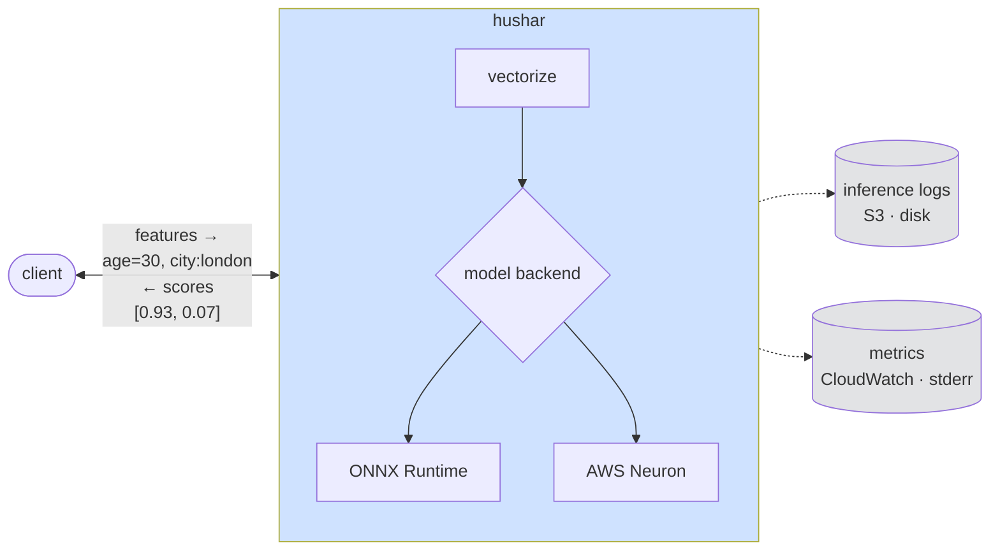
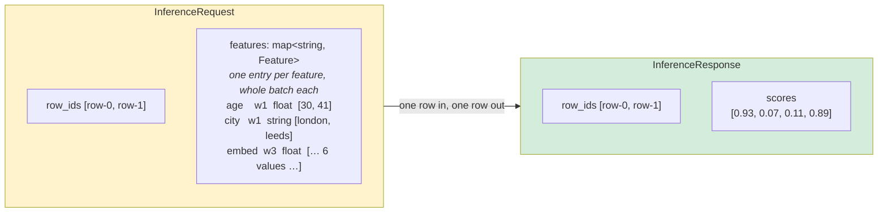

<div align="center">

# hushar &nbsp;·&nbsp; हुशार

**A gRPC server for low-latency tabular model inference.**

`हुशार` is मराठी [ Marāṭhī ] for *intelligent*.

[Quick start](#quick-start) &nbsp;·&nbsp; [The contract](#features-in-scores-out)
&nbsp;·&nbsp; [Performance](#performance) &nbsp;·&nbsp; [Docs](#documentation)

</div>




The dotted arrows never block a response. Everything else about this service follows from
that, and from one more idea: **there is no tensor on the wire.** A caller sends values with
names, and a configuration file, checked against the model at startup, says how they become
model inputs.

---

## Quick start

Pick your hardware. Each guide is five steps, one throwaway model, and one scored request.

| Your hardware | Guide | What is different about it |
|---|---|---|
| any CPU: Graviton, Ampere, Intel, AMD | [quickstart-cpu.md](documentation/quickstart-cpu.md) | nothing to install but the engine; start here if unsure |
| NVIDIA or AMD GPU | [quickstart-gpu.md](documentation/quickstart-gpu.md) | a GPU-enabled engine, one Cargo feature, and a graph that compiles on first use |
| Trainium or Inferentia | [quickstart-neuron.md](documentation/quickstart-neuron.md) | a precompiled NEFF with a fixed batch, placed on NeuronCores |

The engine is loaded at run time and never linked, so every one of those is a download
rather than a build dependency, and one binary reads the same `model.json` on all of them.

## Features in, scores out

```bash
cargo run -p benchmark-client --example smoke
#   row-0 FP32 = [0.9568927, 0.9568927]
```



One request is a batch of rows. Features arrive as a `map<string, Feature>`, one entry per
feature carrying that feature's values for the whole batch, so a name travels once per
request rather than once per row: at 100 rows over 210 features that is 210 names instead
of 21,000. Values may be float, double, int32, int64 or string, one type per feature. Row
identity is `row_ids`, and the response returns the same ids in the same order with one
score buffer for the whole batch.

Already have a finished vector? That is the ordinary case: send it as one entry of that
width with an `identity` transformation, and it reaches the model unchanged.

Anything that speaks protobuf can build the payload, in any language with a generated
client and nothing else to install. [api.md](documentation/api.md) is the full contract;
the definitions are in [`schemas/protos`](schemas/protos/structs.proto).

## Performance

Latency in milliseconds at a rate each host sustained for 15 minutes, with feature
processing on the wire and the inference log sampling a fifth of requests. The accelerator
rows score a whole request in one call, because concurrent calls on one of their sessions
queue on the device. The CPU rows split a request into mini batches, where they overlap.

| accelerator | chip | instance | model | rows x TPS | p50 | p95 | p99 | device busy |
|---|---|---|---|--:|--:|--:|--:|--:|
| CPU | Graviton | c9g.16xlarge | 10M | 100 x 250 | 7.35 | 9.82 | 11.67 | -- |
| CPU | Graviton | c9g.16xlarge | 10M | 500 x 50 | 17.64 | 21.57 | 22.72 | -- |
| CPU | Graviton | c9g.16xlarge | 20M | 100 x 100 | 14.16 | 16.50 | 22.30 | -- |
| CPU | Graviton | c9g.16xlarge | 20M | 500 x 20 | 38.02 | 42.79 | 45.42 | -- |
| GPU | A10G | g5.2xlarge | 10M | 100 x 1000 | 2.63 | 3.14 | 3.50 | 66.3% |
| GPU | A10G | g5.2xlarge | 10M | 500 x 200 | 7.37 | 8.32 | 8.79 | 59.5% |
| GPU | A10G | g5.2xlarge | 20M | 100 x 700 | 4.14 | 5.20 | 5.73 | 96.0% |
| GPU | A10G | g5.2xlarge | 20M | 500 x 150 | 11.86 | 13.44 | 15.66 | 98.9% |
| Trainium | Trainium1 | trn1.2xlarge | 10M | 100 x 1000 | 3.48 | 4.30 | 5.07 | 75.2% |
| Trainium | Trainium1 | trn1.2xlarge | 10M | 500 x 200 | 11.98 | 13.39 | 14.12 | 76.5% |
| Trainium | Trainium1 | trn1.2xlarge | 20M | 100 x 450 | 5.10 | 5.73 | 6.18 | 81.8% |
| Trainium | Trainium1 | trn1.2xlarge | 20M | 500 x 80 | 22.20 | 23.21 | 23.46 | 74.5% |

`device busy` is the accelerator's own occupancy, not its saturation: nvidia-smi's
`utilization.gpu` and Neuron's `neuroncore_utilization` report the share of each sample
period in which the device was executing something, so a higher number does not mean more
work done. On CPU the host is the device. The A10G drew 185-191 W at 10M against 277-289 W
at 20M, which tracks the work more honestly.

**10M and 20M are parameter counts of the same transformer**, and the arithmetic does not
scale with them: one row is 53.3M multiply-accumulates at 10M and 129.0M at 20M, because
depth grows while the entry layer stays fixed. What the models are, where their parameters
sit, and why a matched parameter count is not matched work is in
[benchmark-models.md](scripts/benchmark-models.md).

Full grids, including the mini-batch sweep that produced the CPU rows and a comparison
against Triton, are in [benchmark-data/results](benchmark-data/results/README.md). How a
run is set up and recorded is in [benchmarking.md](documentation/benchmarking.md).

## Where things live

```
hushar/            the service
onnxrt-rs/         safe Rust front end over the ONNX Runtime C API
libnrt-rs/         safe Rust front end over the AWS Neuron C API
hushar/src/inference/{onnx,neuron}_backend.rs   engine adapters
schemas/protos/    gRPC service and message definitions
scripts/           model generators, and scripts/benchmark/ for a two-host run
benchmark-client/  load generator, plus the `smoke` and `inspect_log` examples
benchmark-data/    generated models and retired results (ignored), new results (tracked)
documentation/     the docs below
```

## Documentation

| | Doc | Answers |
|---|---|---|
| **Run it** | [quickstart-cpu.md](documentation/quickstart-cpu.md) | first server and first request, on any CPU |
| | [quickstart-gpu.md](documentation/quickstart-gpu.md) | the same on NVIDIA through TensorRT or AMD through MIGraphX |
| | [quickstart-neuron.md](documentation/quickstart-neuron.md) | the same on Trainium and Inferentia, from NEFF to NeuronCore placement |
| **Use it** | [api.md](documentation/api.md) | the request and response contract, and why it has that shape |
| | [configuration.md](documentation/configuration.md) | every config field, CLI flag, transformation and data type |
| | [hardware.md](documentation/hardware.md) | choosing an execution provider, build features, building a runtime that is not prebuilt |
| | [threads-and-cores.md](documentation/threads-and-cores.md) | thread pools, how many of each, and which cores they run on |
| **Measure it** | [benchmark-data/results](benchmark-data/results/README.md) | the full grids behind the table above |
| | [benchmark-models.md](scripts/benchmark-models.md) | what the benchmark models are, and their arithmetic per row |
| | [benchmarking.md](documentation/benchmarking.md) | a two-host run on real instances, and how a run is recorded |
| **Read it** | [request-walkthrough.md](documentation/request-walkthrough.md) | one request, socket to response, function by function |
| | [bindgen.md](documentation/bindgen.md) | why the FFI bindings are checked in and the library loaded at run time |

## Testing

Unit tests need nothing. The tests that exercise real inference skip with a reason when no
ONNX Runtime is present, so the suite stays green everywhere.

```bash
cargo test                   # unit tests only
export ORT_DYLIB_PATH=…      # a library from any quick start, step 1
cargo test                   # everything, on CPU
cargo test --features tensorrt   # plus TensorRT, on an NVIDIA host
cargo test -p hushar neuron      # Neuron signature and config tests; hardware validation uses a NEFF
```

## Licence

MIT. See [LICENSE](LICENSE).
