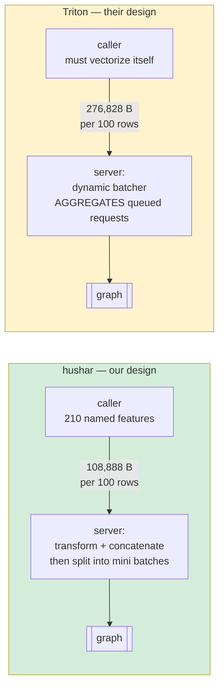

# design-vs-triton-cpu-arm64-10M — runbook


## The question

The like-for-like comparison is closed: `minibatch-rows-cpu-arm64-10M` gave both stacks
identical bytes, one graph call each, matched spinning, and put hushar within 6% of
Triton. This run asks the question a reader actually has:

**Given the same traffic, which design serves it better, each at its own best?**

The traffic is fixed and real: *N* candidates, each described by 210 named features.
What the two designs ask **of the caller** differs, and that difference *is* the design.



Note the two servers pull in **opposite directions**: hushar splits one request into
concurrent mini batches to cut its latency; Triton's dynamic batcher merges queued
requests into one bigger call to raise its throughput. Comparing them is the point.

The payload figures above are measured, not computed — `benchmark-client` now prints the
encoded size of a real request. Our contract moves **2.54× less data**.

## Three arms, because two cannot separate the wire from the server

| arm | stack | wire | what it is |
|---|---|---|---|
| `H` | hushar | 210 named features | **our design**, end to end |
| `T` | Triton | 690-float tensor | **their design**, at its best configuration |
| `X` | hushar | 690-float tensor | **control** |

`H − X` is the cost of the feature API. `X − T` is the two servers on identical bytes.
Without `X` a reader cannot tell which of the two a gap between `H` and `T` came from.
Every rung carries all three, measured back to back on one host.

## What the caller pays, and why it is not in the latency column

Triton's contract does not remove the 210 transformations — it moves them to the caller,
usually per candidate rather than per batch, in whatever language the caller happens to
be. That cost is reported **separately and as a lower bound**, from two things the run
already collects:

- `VectorizationTime`, which hushar publishes on every `H` cell: the same work in batched
  Rust, and therefore the cheapest it can possibly be. The previous campaign measured
  13 µs for one row converging to 1.3 µs/row by 200.
- the encoded payload size each client prints.

Charging Triton for a strawman client would be the easier claim and the weaker one.

## Two phases

### `PHASE=tune` — establish "best", don't assert it

**5-minute** window, one stack per lane, **two** load points: 10,000 rows/s (about half the
host) and 24,000 rows/s (inside the bracket the previous campaign left for the ceiling). A
ranking does not need fifteen minutes; it needs every candidate to meet the same traffic on
the same host, minutes apart.

Two loads, not one, because of Triton's dynamic batcher specifically. At 10,000 rows/s the
queue is too shallow for it to find company, so every delay setting would look like no
batching at all and Triton's own best lever would be ranked on a load where it cannot work.

**One pass per row count** (`TUNE_ROWS`), because a winner at one row count is not a winner
at another: a mini batch of 4 is a 25-piece fan-out on a 100-row request and a **50-piece**
one on a 200-row request, and the 100-row pass showed the fan-out's width against the
session count is exactly what decides the ranking — two sessions could not absorb 25 pieces
at all. The 200-row pass therefore sweeps the mini-batch width properly (`rows`, 2, 4, 8,
16 → no split, 100, 50, 25, 13 pieces) and keeps one `spin1` anchor so it re-confirms the
spinning finding on its own row count rather than inheriting it.

| lane | stack | candidates |
|---|---|---|
| hushar | mini-batch width × `spin0`, one `spin1` anchor, and `mb4` at `8×8` and `2×32` |
| Triton | `4×16`, `8×8`, `2×32`, `16×4`, `4×16` parallel-execution, and the **dynamic batcher** at queue delays 0 / 200 / 1000 µs |

16 cells each (8 configs × 2 loads), ~2.8 h per lane, both lanes in parallel.

**The 200-row pass ran on a SECOND RIG** (`RIG_SET=tune200`, hosts `c9g-3`/`c9g-4` and
clients `cl3`/`cl4`, its own `rig-state-tune200.json`), because it was added while the
head-to-head was already measuring on the first and tuning on a busy host would have
contaminated both. Each rig set owns its state file, so neither can terminate the other's
instances. Terminate it as soon as its cells are collected:

```bash
RIG_SET=tune200 CONFIRM=terminate python rig.py terminate
```

### `PHASE=head` — the result, 15 minutes per cell

Winners pinned via `BEST_HUSHAR` / `BEST_TRITON` as JSON, so the head-to-head *names* the
configurations it ran. Left unset it falls back to the previous campaign's winners **and
records `tuned: false`** so the report must say so.

**Measured 2026-10-23/24, 32 cells, 0 problems:**

```bash
export BEST_HUSHAR='{"mb":4,"spin":0,"sessions":4,"width":16}'
export BEST_TRITON='{"instances":4,"width":16,"exec_mode":"0","max_batch":0,"delay_us":0}'
```

Two findings came out of the tuning pass and both changed this run.

**Triton's dynamic batcher does not help this workload.** At 24,000 rows/s, no batching is
p50 12.72 / p95 16.99; delay 0 µs is 12.98 / 27.95; delay 1000 µs is 14.20 / 30.54. With
100 rows already in a request the graph call is wide already, so merging requests only adds
queue delay. `inter`-op parallel execution collapses outright — 29.7/240 req/s at 13% CPU,
because the graph is one chain and there is nothing to run in parallel. `2×32` wins on p50
at 10,000 rows/s but at 91% CPU, and at 24,000 its p95 is 1,410 ms. So Triton's best is
`4×16` intra-op, `max_batch_size: 0`.

**For hushar, spinning off is not a CPU optimisation — it is load-bearing.** Same mini
batch, spinning the only difference, at 24,000 rows/s:

| config | state | achieved | p50 | p95 | CPU |
|---|---|--:|--:|--:|--:|
| `mb4 spin0` | sustained | 240/240 | **6.70** | 9.82 | **69.8%** |
| `mb4 spin1` | **failed** | 160.8/240 | 5960 | — | 98.9% |
| `mbrows spin1` | sustained | 240/240 | 13.37 | 24.57 | 95.3% |

One holds the rate with 30% of the host spare; the other sheds 32,172 requests. The split's
parallelism comes from the fan-out, and a spinning pool competes with it for the same
cores — at half load that merely wastes CPU, at full load it starves the split.

**One configuration is not best for all traffic, and `BEST_HUSHAR_BY_ROWS` says so.**
The 100-row pass chose spinning off. None of that reasoning survives at one row: there is
no split, the intra-op pool is the only parallelism, and the previous campaign measured
spinning off shedding 684,719 requests at 8,000 rows/s. So the one-row ladder runs `spin1`,
every cell records the policy it ran, and a table putting them side by side has to say so.
Nor does a width chosen at 100 rows necessarily hold at 200, where the same mini batch is
twice the fan-out — hence the 200-row tuning pass, whose winner is pinned the same way:

```bash
export BEST_HUSHAR_BY_ROWS='{"200": {"mb":8,"spin":0,"sessions":4,"width":16}}'   # example
export BEST_TRITON_BY_ROWS='{"200": {"instances":8,"width":8}}'                   # example
```

Triton has no equivalent choice over spinning — its backend forwards no spinning key at
all, which is a limitation rather than a setting, and the report should name it as one.

If the 200-row winner differs from the 100-row one and lane A has already measured 200-row
cells with the old pin, delete those cells from S3 and re-run the lane; it skips whatever
remains and re-measures only what was removed.

| lane | rows/request | arms | ladder (rows/s) |
|---|---|---|---|
| c9g-1 | 100, 200 | H, T, X | 20k / 24k / 28k / 32k / 36k / 40k |
| c9g-2 | 1 | H, T, X | 4k / 6k / 8k / 10k / 12k |
| c9g-2 | 100 | P ×3 at 10k | — |

The ladder reaches 40,000 because the tuning moved the target: hushar held 24,000 at 69.8%
CPU (linear estimate of its ceiling ≈ 34,000) while Triton held the same rate at 97.5% and
cannot be far above it. A ladder stopping at 32,000 would have bracketed Triton and merely
bounded hushar from below.

One row per request is the design's **worst** case — nothing to split, nothing to amortize
210 transformations over — so it is measured on purpose rather than omitted. A mini batch no
narrower than the request is not a split, so those cells record `mb_clamped`.

Worst case 54 cells, ~20.8 min each; ladders stop at their first unsustained rung, so
expect ~32 and **~9 h** wall clock (lane A is the long one).

## Sustained means every slice

One continuous 900 s load, reported by **both** clients as three consecutive 300 s slices.
`sustained` requires every slice to have held; a cell that held some is `partial` with the
slice it broke in. A five-minute window cannot tell a rate that is sustained from a rate
that is sustained for five minutes.

A ladder stops on `failed`, or on a **second consecutive** `partial` — one `partial` is the
most interesting result this run can produce, so the rung above it is worth measuring.

---

## The AMI, and why it is an input

The previous rig was terminated because its AL2023 image was flagged as an outdated OS.
The structural fix is in how the rig is owned: `rig.py launch` creates hosts from a
**freshly resolved** image and `rig.py terminate` destroys them, so nothing survives to
go stale. `launch` refuses an image older than 45 days.

**Nebula AMI 2 (NAMI) could not be wired up from this machine.** Three findings:

1. The image id and the account onboarding both go through
   `nebulaamiregistryservice-ca.corp.amazon.com`, which is corporate-DNS only — `NXDOMAIN`
   from a machine that merely holds AWS credentials, and the internal web proxy does not
   reach it either.
2. Nothing Nebula-owned is shared with this account today, so there is no AMI to select
   even if one were named.
3. NAMI has been in KTLO since 2026-04-30 and its own wiki discourages new onboarding.

So it is an **input**, not a constant. From a machine on the corporate network:

```bash
ACC=$(cat ../../../../.account-ids)          # not written into any tracked file
curl -v -X PUT "https://nebulaamiregistryservice-ca.corp.amazon.com/accounts/$ACC"
curl "https://nebulaamiregistryservice-ca.corp.amazon.com/images?region=us-west-2\
&organization=cdo&function=bastion&baseOs=amazonlinux&baseVersion=2.0-aarch64\
&vendorGuidance=recommended"
```

Then `AMI_ID=ami-... rig.py launch`. NAMI carries InfoSec agents that consume CPU on the
hosts being measured, so compare the first cell's utilization against the previous
campaign before trusting the run. With no `AMI_ID`, `launch` uses the current AL2023 arm64
release — the same distribution the previous campaign measured.

---

## Run it

Everything is detached and resumable. The laptop may be closed, or offline, for the whole
run: each cell and each lane log goes to S3 as it completes, and `watch.sh` reads the
bucket alone and makes no SSM call.

```bash
cd benchmark-data/private/design-vs-triton-cpu-arm64-10M/driver
export HUSHAR_BENCH_BUCKET=hushar-bench-$(cat ../../../../.account-ids)-us-west-2
export AWS_PROFILE=hushar-bench AWS_DEFAULT_REGION=us-west-2
. /Users/pratbarh/miniconda3/etc/profile.d/conda.sh && conda activate local
```

### 1 · package  (laptop, ~2 min)

```bash
HUSHAR_BENCH_BUCKET=$HUSHAR_BENCH_BUCKET ./package.sh
# prints REV=... MODEL_MD5=... -- export both
```

### 2 · launch the rig, install keys  (~6 min)

```bash
python rig.py launch          # add AMI_ID=... for a Nebula image
python rig.py status
python keys.py                # one ephemeral keypair per lane
```

Four instances: two `c9g.16xlarge` servers, two `m9g.8xlarge` clients, all in
`us-west-2a`, no public address, no key pair. Ids land in `rig-state.json` (gitignored).

### 3 · deploy  (~12 min)

```bash
python fanout.py sweep -f deploy.sh \
  --env REV=$REV --env MODEL_MD5=$MODEL_MD5 --env MODEL_SIZE=10m \
  --env HUSHAR_BENCH_BUCKET=$HUSHAR_BENCH_BUCKET \
  --env RUN_NAME=design-vs-triton-cpu-arm64-10M --timeout 2400

python fanout.py sweep -f deploy_triton.sh \
  --env REV=$REV --env MODEL_MD5=$MODEL_MD5 --env MODEL_SIZE=10m \
  --env HUSHAR_BENCH_BUCKET=$HUSHAR_BENCH_BUCKET --timeout 2400
```

`deploy.sh` uploads each host's kernel/AMI block to `runs/<run>/raw/hostinfo/` straight
away, so provenance is in S3 before the first cell rather than captured in a hurry at the
end — the one thing the previous campaign nearly lost.

```bash
RIG=$(python -c "
import hosts; print(';'.join(f'{n}={h[\"ip\"]}' for n,h in sorted(hosts.live().items()) if h['role']=='server'))")
echo "$RIG"
```

### 4 · tune  (~2.8 h, detached)

```bash
python fanout.py clients -f launch.sh \
  --env REV=$REV --env MODEL_MD5=$MODEL_MD5 --env RIG="$RIG" \
  --env HUSHAR_BENCH_BUCKET=$HUSHAR_BENCH_BUCKET \
  --env PHASE=tune --env LANE_TAG=tune \
  --env RUN=design-vs-triton-cpu-arm64-10M-tune \
  --env DURATION=300 --env SETTLE=45 --timeout 300
```

Own run name, so tuning cells never land among the results. When both lanes report
`LANE COMPLETE`, collect and rank:

```bash
HUSHAR_BENCH_BUCKET=$HUSHAR_BENCH_BUCKET \
  python collect.py design-vs-triton-cpu-arm64-10M-tune
```

Rank on **sustained first, then p95, then p50** within each load point — a configuration
that sheds is not a faster version of one that holds, and among those that held, the
achieved rate is a pass/fail already carried by `sustained`, so ranking passes by how far
they passed ranks them by noise (240.4 against 240.0 req/s is +0.17%). `verify_tune.py`
checks the named winner against this rule; the first draft ranked on achieved rate and
picked a configuration whose p95 was 1,410 ms. Then pin:

```bash
export BEST_HUSHAR='{"mb":4,"spin":1,"sessions":4,"width":16}'
export BEST_TRITON='{"instances":4,"width":16,"exec_mode":"0","max_batch":0,"delay_us":0}'
```

### 5 · the head-to-head  (~8 h, detached)

```bash
python fanout.py clients -f launch.sh \
  --env REV=$REV --env MODEL_MD5=$MODEL_MD5 --env RIG="$RIG" \
  --env HUSHAR_BENCH_BUCKET=$HUSHAR_BENCH_BUCKET \
  --env BEST_HUSHAR="$BEST_HUSHAR" --env BEST_TRITON="$BEST_TRITON" --timeout 300
```

Then stop looking at it. Check again in a few hours:

```bash
HUSHAR_BENCH_BUCKET=$HUSHAR_BENCH_BUCKET ./watch.sh
```

A lane is finished when its report says `LANE COMPLETE`. Re-running step 5 resumes a lane
that died: it skips every cell S3 already holds and reaches the same early stops, because
the stop is re-derived from the recorded verdicts rather than kept in memory.

### 6 · collect, then destroy the rig

```bash
HUSHAR_BENCH_BUCKET=$HUSHAR_BENCH_BUCKET python collect.py
CONFIRM=terminate python rig.py terminate
```

Terminate rather than stop: a stopped instance keeps the kernel it was launched with,
which is how the last rig came to be flagged. Everything needed is in S3 by then.
