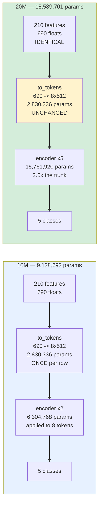
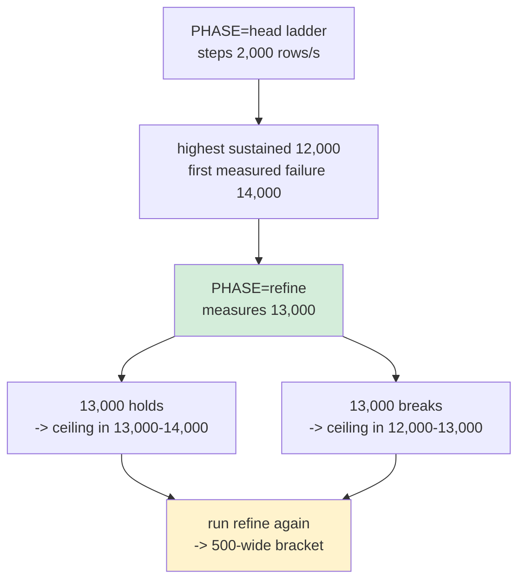

# design-vs-triton-cpu-arm64-20M — runbook

## The question

Two questions are already closed. `minibatch-rows-cpu-arm64-10M` made the like-for-like
comparison — identical bytes, identical graph, one graph call each — and put hushar within
6% of Triton. `design-vs-triton-cpu-arm64-10M` ran the design comparison with a control
arm and found hushar 1.9–2.8× faster at 100 and 200 rows. This run asks only:

**Does the design's advantage survive a model twice the weight, and where is each stack's
ceiling of sustained load?**

## The 2× model, and what exactly is doubled

Five encoder layers instead of two. Nothing else changes: same 210 features, same
690-float input, same thirteen ONNX operator types, same matmul shapes. ONNX Runtime
therefore selects the same kernels, so a 10M↔20M difference is **more of the same work**
rather than different work.



| | 10M | 20M | ratio |
|---|--:|--:|--:|
| parameters | 9,138,693 | 18,589,701 | **2.03×** |
| MACs per row | 53,288,960 | 128,983,040 | **2.42×** |
| onnx bytes | 36,571,281 | 74,398,005 | 2.03× |
| input width | 690 | 690 | 1.00× |
| ONNX op types | 13 | 13 | identical |

**Why the two ratios differ, and why that is not a sizing error.** `to_tokens` is a
`Linear(690 → 8×512)` applied **once per row**, so it costs 2,830,336 parameters at any
model size. Holding the input width at 690 is mandatory — change it and the wire bytes
change and nothing is comparable with the 10M campaign — which pins that layer as a
constant, so every added parameter lands in the trunk. Its share falls from 31.0% to
15.2%.

The alternative was considered and rejected. Doubling the token axis (8 → 16, 4 layers)
lands parameters at exactly 2.00× and keeps **every component's share identical**, but
attention is quadratic in tokens, so it carries **3.90×** the arithmetic. The option that
distributes weights perfectly is the one that distorts compute worst, so a "2× model"
label would then be misleading in precisely the dimension a latency benchmark feels.

**The consequence is this run's hypothesis.** A heavier trunk amortizes the feature path
better, so hushar's margin over Triton should **narrow**. A run that found the margin
unchanged would be the surprising result. Either way the report states which it measured,
and quotes both ratios rather than rounding to "2×".

## Two arms, not three

| arm | stack | wire | what it is |
|---|---|---|---|
| `H` | hushar | 210 named features | **our design**, end to end |
| `T` | Triton | 690-float tensor | **their design**, at its best configuration |
| `P` | hushar | 210 named features | noise floor, 3 repeats below the ceiling |

The 10M campaign's control arm `X` (hushar on Triton's tensor contract) is **not
scheduled**. It answered its question: the graph cost was identical on both wires
(`InferenceTime` 4.66 vs 4.64 ms), so every H−T difference sits outside the graph, and the
feature wire *won* at 100 and 200 rows by 3.5–6.1% because it moves 2.54× fewer bytes.
Re-measuring that at 2× weight would spend a third of the rig re-confirming a settled
attribution. `ARMS_HEAD["X"]` stays resolvable so a follow-up probe can price the wire
again without a new driver.

## Finding the ceiling is the point

The 10M campaign stepped 4,000 rows/s and left the 100-row ceiling bracketed
28,000–32,000. That answers "is it above 28,000", not "where is it". This run:

1. steps **2,000** rows/s at 100 and 200 rows, and **1,000** at one row, then
2. **bisects** — `PHASE=refine` reads the collected verdicts, finds each ladder's highest
   sustained rung and the lowest rung that was measured and did not hold, and measures the
   midpoint.



A rung the early stop **skipped** is never an upper bound: skipped cells go to
`failures/`, not `cells/`, so `refine_brackets` cannot see one. Verified by unit test, and
so is the case where the ceiling is above the whole ladder (nothing to bisect, which is a
finding for the report rather than something refining can fix).

The rungs are centred on the 10M ceilings divided by the per-row cost this model added —
about **2.1×**, once `InferenceTime`'s ~79% share of p50 is accounted for — putting the
100-row ceilings near 13,000–15,000 rows/s against 28,000–32,000 at 10M. The lowest rung
sits deliberately below every estimate: a ladder whose first rung already sheds stops
immediately and produces nothing, which after eight hours of rig is the one failure worth
buying insurance against.

`LADDER_1`, `LADDER_100` and `LADDER_200` are environment inputs, because the tuning pass
measures 8,000 and 12,000 rows/s hours before the head-to-head starts and may show the
estimate is wrong. Retuning the ladder must not mean editing a deployed file.

## Four pairs, so the tuning is parallel

The 10M campaign launched two pairs, tuned hushar on one and Triton on the other, then had
to launch a **second rig** when the 200-row pass was added — tuning on a host that is
already measuring contaminates both. Four pairs run all four combinations at once.

| phase | c9g-1 | c9g-2 | c9g-3 | c9g-4 | longest lane |
|---|---|---|---|---|--:|
| `tune` | hushar @100 | Triton @100 | hushar @200 | Triton @200 | **2.8 h** |
| `head` | 100 rows H+T | 200 rows H+T | 1 row H+T | P ×3 | **4.9 h** |
| `refine` | 100 rows | 200 rows | 1 row | — | **0.7 h** |

Shorter wall clock is not only cheaper here. This run is driven from a laptop expected to
disconnect, so the less time there is after the last cell, the less time the rig can sit
running unattended — which is exactly how the 10M campaign left four instances idle for
about eight hours.

Each row count lives entirely on one host, because the 10M campaign measured a placement
offset between two instances of the same type that repeating does not reduce.

## Tuning: pruned, not inherited

Re-tuning is not a formality — doubling the arithmetic per mini-batch piece is exactly the
kind of change that moves a split's optimum. But three 10M findings were unambiguous
enough to prune the candidate list:

- **`inter`-op parallel execution is gone.** It achieved 29.7 of 240 req/s at 13% CPU,
  because the graph is one chain with nothing to run in parallel. A deeper chain of five
  layers cannot make that better.
- **The dynamic batcher keeps one probe at 0 µs**, not three delays. At 10M it was a wash
  at both row counts (12.72/16.99 ms unbatched against 12.98/27.95 at 0 µs and
  14.20/30.54 at 1000 µs), because a 100-row request already makes the graph call wide.
  One probe says whether 2× the weight changed that.
- **Spinning keeps one anchor cell.** `mb4 spin0` held its rate on 69.8% of the host while
  `mb4 spin1` shed 32,172 requests. The anchor re-confirms it at this weight rather than
  inheriting it.

The **session-width split is swept in full** and deliberately not pruned. It is the lever
most exposed to the model's weight: a heavier graph call changes how much a single
instance's intra-op pool can usefully absorb, and `2x32` was already the p50 winner at
half load at 10M before its 1,410 ms p95 disqualified it.

Rank on **sustained first, then p95, then p50** within each load point. A configuration
that sheds is not a faster version of one that holds, and among those that held the
achieved rate is a pass/fail already carried by `sustained` — so ranking passes by how far
they passed ranks them by noise. The 10M campaign's first draft ranked on achieved rate
and picked a configuration whose p95 was 1,410 ms.

Two load points, because one cannot rank these candidates: `mb4 spin0` and `mb4 spin1` are
indistinguishable at half load and 150× apart at full load.

## Sustained means every slice

One continuous 900 s load, reported by both clients as three consecutive 300 s slices.
`sustained` requires every slice to have held; a cell that held some is `partial` with the
slice it broke in. A five-minute window cannot tell a rate that is sustained from a rate
that is sustained for five minutes.

A ladder stops on `failed`, or on a **second consecutive** `partial` — one `partial` is
the most interesting result this run can produce, so the rung above it is worth measuring.

## Matched engines, enforced rather than intended

Both stacks must score the graph with the same ONNX Runtime, or the comparison is between
two engines. This is structural, not a checklist item:

| check | where | what it does |
|---|---|---|
| hushar's ORT | `deploy.sh` | installs the official CPU build of exactly `ORT_VER=1.28.0` |
| Triton's ORT | `deploy_triton.sh` | `strings` the container's `libonnxruntime.so` and **refuses to deploy** on a mismatch |
| at run time | `sweep.py` `start_hushar` | aborts the cell unless the server's own banner says `(runtime 1.28.0)` |
| the graph | four places | `MODEL_MD5` is checked by both deploy scripts, the Triton model load, and the preflight |

`nvcr.io/nvidia/tritonserver:26.08-py3` ships ORT 1.28.0, which is why that tag is pinned.
Passing the 20M md5 `30f9c5330b808a34b55fe88048a20da6` makes it structurally impossible
for this campaign to serve the 10M graph by accident.

---

## Run it

Everything is detached and resumable. The laptop may be closed, or offline, for the whole
run: each cell and each lane log goes to S3 as it completes, and `watch.sh` reads the
bucket alone and makes no SSM call.

```bash
cd benchmark-data/private/design-vs-triton-cpu-arm64-20M/driver
export HUSHAR_BENCH_BUCKET=hushar-bench-$(cat ../../../../.account-ids)-us-west-2
export AWS_PROFILE=hushar-bench AWS_DEFAULT_REGION=us-west-2
. /Users/pratbarh/miniconda3/etc/profile.d/conda.sh && conda activate local
```

### 0 · generate the model  (laptop, ~2 min, once)

```bash
cd ../../../..
python scripts/generate_benchmark_models.py --params 20M --out-dir benchmark-data/generated/20m
python benchmark-data/private/design-vs-triton-cpu-arm64-20M/driver/make_tensor_config.py \
    benchmark-data/generated/20m
cd benchmark-data/private/design-vs-triton-cpu-arm64-20M/driver
```

Expect `5 encoder layers, 18,599,941 parameters` and `features FP32[rows,690]`. The md5
must be `30f9c5330b808a34b55fe88048a20da6`; the generator is seeded, so it reproduces.

### 1 · package  (laptop, ~2 min)

```bash
MODEL_SIZE=20m ./package.sh
# prints REV=... MODEL_MD5=... -- export both
```

### 2 · launch the rig, install keys  (~6 min)

```bash
python rig.py launch          # refuses an AMI older than 45 days
python rig.py status
python keys.py                # one ephemeral keypair per lane
```

Eight instances: four `c9g.16xlarge` servers, four `m9g.8xlarge` clients, all in
`us-west-2a`, no public address, no key pair. Ids land in `rig-state.json` (gitignored).

### 3 · deploy  (~12 min)

```bash
python fanout.py sweep -f deploy.sh \
  --env REV=$REV --env MODEL_MD5=$MODEL_MD5 --env MODEL_SIZE=20m \
  --env HUSHAR_BENCH_BUCKET=$HUSHAR_BENCH_BUCKET \
  --env RUN_NAME=design-vs-triton-cpu-arm64-20M --timeout 2400

python fanout.py sweep -f deploy_triton.sh \
  --env REV=$REV --env MODEL_MD5=$MODEL_MD5 --env MODEL_SIZE=20m \
  --env HUSHAR_BENCH_BUCKET=$HUSHAR_BENCH_BUCKET --timeout 2400

RIG=$(python -c "
import hosts; print(';'.join(f'{n}={h[\"ip\"]}' for n,h in sorted(hosts.live().items()) if h['role']=='server'))")
echo "$RIG"
```

### 4 · tune  (~2.8 h, detached)

```bash
python fanout.py clients -f launch.sh \
  --env REV=$REV --env MODEL_MD5=$MODEL_MD5 --env RIG="$RIG" \
  --env HUSHAR_BENCH_BUCKET=$HUSHAR_BENCH_BUCKET \
  --env PHASE=tune --env LANE_TAG=tune \
  --env RUN=design-vs-triton-cpu-arm64-20M-tune \
  --env DURATION=300 --env SETTLE=45 --timeout 300
```

Own run name, so tuning cells never land among the results. Each lane takes its stack and
row count from `LANES_TUNE`, so one invocation covers all four combinations. When every
lane reports `LANE COMPLETE`:

```bash
HUSHAR_BENCH_BUCKET=$HUSHAR_BENCH_BUCKET python collect.py design-vs-triton-cpu-arm64-20M-tune
```

Rank, then pin — and if the ceilings the tuning implies differ from the estimate, retune
the ladder here rather than discovering it rung by rung:

```bash
export BEST_HUSHAR='{"mb":4,"spin":0,"sessions":4,"width":16}'
export BEST_TRITON='{"instances":4,"width":16,"exec_mode":"0","max_batch":0,"delay_us":0}'
export BEST_HUSHAR_BY_ROWS='{"200": {"mb":8,"spin":0,"sessions":4,"width":16}}'   # if it differs
# export LADDER_100=10000,12000,14000,16000,18000,20000                           # if needed
```

### 5 · the head-to-head  (~4.9 h, detached)

```bash
python fanout.py clients -f launch.sh \
  --env REV=$REV --env MODEL_MD5=$MODEL_MD5 --env RIG="$RIG" \
  --env HUSHAR_BENCH_BUCKET=$HUSHAR_BENCH_BUCKET \
  --env BEST_HUSHAR="$BEST_HUSHAR" --env BEST_TRITON="$BEST_TRITON" \
  --env BEST_HUSHAR_BY_ROWS="${BEST_HUSHAR_BY_ROWS:-}" \
  --env LADDER_100="${LADDER_100:-}" --env LADDER_200="${LADDER_200:-}" \
  --env LADDER_1="${LADDER_1:-}" --timeout 300
```

Then stop looking at it. Check again in a few hours:

```bash
HUSHAR_BENCH_BUCKET=$HUSHAR_BENCH_BUCKET ./watch.sh
```

A lane is finished when its report says `LANE COMPLETE`. Re-running step 5 resumes a lane
that died: it skips every cell S3 already holds and reaches the same early stops, because
the stop is re-derived from the recorded verdicts rather than kept in memory.

### 6 · refine the ceilings  (~0.7 h, detached)

```bash
python fanout.py clients -f launch.sh \
  --env REV=$REV --env MODEL_MD5=$MODEL_MD5 --env RIG="$RIG" \
  --env HUSHAR_BENCH_BUCKET=$HUSHAR_BENCH_BUCKET \
  --env PHASE=refine --env LANE_TAG=refine \
  --env BEST_HUSHAR="$BEST_HUSHAR" --env BEST_TRITON="$BEST_TRITON" \
  --env BEST_HUSHAR_BY_ROWS="${BEST_HUSHAR_BY_ROWS:-}" --timeout 300
```

Writes into the **same** run, so the refined rung joins the ladder it refines. Run it a
second time to halve the bracket again. A lane with nothing to bisect says so and exits.

### 7 · collect, then destroy the rig

```bash
HUSHAR_BENCH_BUCKET=$HUSHAR_BENCH_BUCKET python collect.py
CONFIRM=terminate python rig.py terminate
```

Terminate rather than stop: a stopped instance keeps the kernel it was launched with,
which is how the 10M campaign's first rig came to be flagged for an outdated OS.
Everything needed is in S3 by then.

### Total

| step | wall clock |
|---|--:|
| generate, package, launch, deploy | ~0.4 h |
| tune | ~2.8 h |
| head-to-head | ~4.9 h worst case, less with early stops |
| refine ×2 | ~1.4 h |
| collect, report, terminate | ~0.3 h |
| **total** | **~10 h**, of which ~9 h is unattended |
