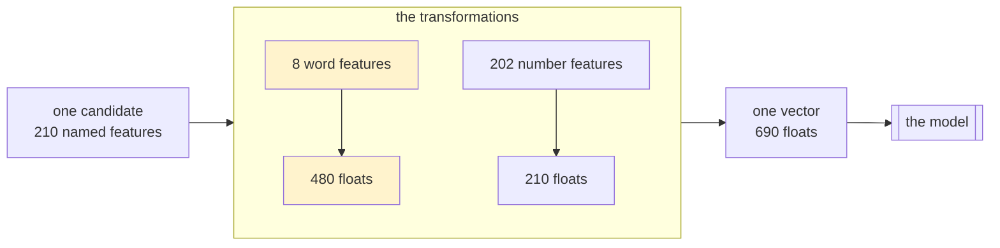
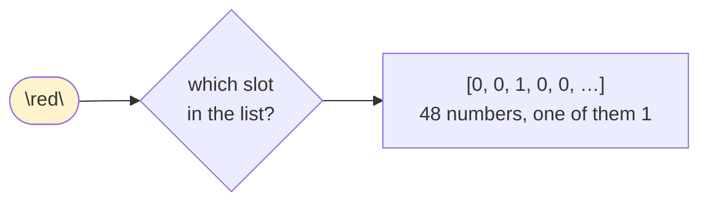
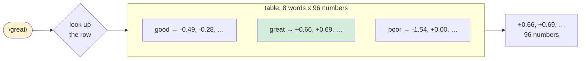
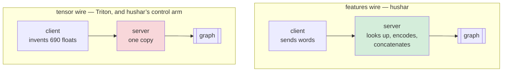

# minibatch-rows-cpu-arm64-10M

**The question.** Scoring many candidates in one request is supposed to be cheaper per candidate than scoring them one at a time, and splitting such a request into mini batches scored at once is supposed to cut its latency. This run makes **rows per request** the primary axis and measures both, against Triton serving the same graph so the result is a property of the workload rather than of one server.

**Model** — transformer encoder, 10 M parameters, 2 layers, **vectorized**: the service transforms every feature and concatenates them into the graph's one `features FP32[rows, 690]` input. `bench_model.onnx`, md5 `5539c97131c896db6c58088d9f9b9ee3`, 36,571,281 B, checked on every server host before it was allowed to measure. One model loaded, one arm.

**Two wires, one graph.** hushar's contract is named features; Triton's is the tensor. Comparing them as they stand would measure two servers and 210 transformations at once, so every cell names which wire it ran:

| wire | the caller sends, per row | the server does before the graph |
|---|---|---|
| `features` | 210 named features | 210 transformations, concatenate to 690 |
| `tensor` | one 690-float array | one copy, an `identity` transformation 690 wide |

Both reach the identical graph. The `tensor` wire is the only one on which the two stacks can be compared, and the gap between the wires is what hushar's feature API costs.

**One engine on both sides.** ONNX Runtime 1.28.0 on hushar and inside `nvcr.io/nvidia/tritonserver:26.08-py3`. Every hushar cell reads the version out of the server's own banner and is abandoned if it disagrees; the Triton arm reads it out of the image and refuses to start otherwise.

**Spinning is symmetric here, for the first time.** Triton's onnxruntime backend forwards no `session.*.allow_spinning` key and drops unknown `parameters` silently, so Triton always runs ONNX Runtime's default spin. Earlier campaigns compared it against a hushar whose threads slept, and had to discount every ratio for it. Here the hushar side of every Triton comparison runs `allow_spinning: true` as well. Spinning is not assumed safe elsewhere: it is a measured axis, and the section *Spinning* below shows it wins in one regime and loses in the other.

72 cells — 67 hushar and 5 Triton — of which 68 held the rate they were offered. 0 requests failed anywhere in the run. The four cells that did not hold their rate are the deliberate tops of capacity ladders and one spinning collapse, all reported where they belong.

Rows per request swept 1, 5, 10, 25, 50, 100, 200. Every hushar cell ran 4 sessions of 16 intra-op threads (64 threads on 64 vCPUs) with `worker_threads` 32 and `connection_concurrency` 512; Triton ran the matching `instance_group.count` 4 with `intra_op_thread_count` 16 and `max_batch_size: 0`. Feature logging was off.

**Utilization in every table.** CPU is whole-host busy time taken from the scheduler's own run-time counters (`/proc/schedstat`), not the tick-based `/proc/stat` columns, which on this tickless kernel can account a busy CPU as idle; both readings are kept per cell. Memory is whole-host memory used including page cache, which is the only memory figure comparable across the two stacks because the sampler does not own Triton's container PID.

## The answer: what a candidate costs, against candidates per request

Row throughput is held constant down each table and only the packaging changes, so a column of cells is the same work arriving differently. `per candidate` is the client median divided by the rows in the request. `engine` is the server's own `InferenceTime` median, published per scored batch to CloudWatch, so `overhead` is everything the request costs outside the engine call: the wire, admission, vectorization and dispatch.

Spinning is on in both tables. Idle threads therefore hold cores, so read CPU here as cores occupied rather than work done; the sleeping measurements are under *Spinning*.

### 2,000 rows per second offered

| rows/request | req/s | p50 ms | p95 ms | per candidate | engine ms | engine/row | overhead ms | overhead share | CPU | cell |
|--:|--:|--:|--:|--:|--:|--:|--:|--:|--:|---|
| 1 | 2000 | 0.85 | 1.35 | 0.850 | 0.36 | 0.360 | 0.49 | 57.6% | 80.2% | `c9g-1-R-l2000-r1t2000-spin1` |
| 5 | 400 | 1.47 | 1.51 | 0.294 | 1.02 | 0.203 | 0.45 | 30.8% | 24.3% | `c9g-1-R-l2000-r5t400-spin1` |
| 10 | 200 | 1.79 | 1.99 | 0.179 | 1.49 | 0.149 | 0.30 | 16.9% | 24.0% | `c9g-1-R-l2000-r10t200-spin1` |
| 25 | 80 | 3.66 | 3.86 | 0.146 | 2.97 | 0.119 | 0.69 | 18.7% | 23.9% | `c9g-1-R-l2000-r25t80-spin1` |
| 50 | 40 | 6.55 | 6.65 | 0.131 | 5.79 | 0.116 | 0.76 | 11.7% | 16.8% | `c9g-1-R-l2000-r50t40-spin1` |
| 100 | 20 | 11.66 | 11.76 | 0.117 | 10.82 | 0.108 | 0.84 | 7.2% | 10.9% | `c9g-1-R-l2000-r100t20-spin1` |
| 200 | 10 | 22.49 | 22.58 | 0.112 | 21.36 | 0.107 | 1.13 | 5.0% | 8.0% | `c9g-1-R-l2000-r200t10-spin1` |

### 8,000 rows per second offered

| rows/request | req/s | p50 ms | p95 ms | per candidate | engine ms | engine/row | overhead ms | overhead share | CPU | cell |
|--:|--:|--:|--:|--:|--:|--:|--:|--:|--:|---|
| 1 | 8000 | 4.91 | 38.80 | 4.910 | 0.37 | 0.373 | 4.54 | 92.4% | 99.8% | `c9g-1-R-l8000-r1t8000-spin1` |
| 5 | 1600 | 1.59 | 2.98 | 0.318 | 1.09 | 0.217 | 0.50 | 31.6% | 85.8% | `c9g-1-R-l8000-r5t1600-spin1` |
| 10 | 800 | 1.99 | 2.17 | 0.199 | 1.49 | 0.149 | 0.50 | 25.2% | 57.7% | `c9g-1-R-l8000-r10t800-spin1` |
| 25 | 320 | 3.73 | 3.93 | 0.149 | 3.08 | 0.123 | 0.65 | 17.6% | 46.4% | `c9g-1-R-l8000-r25t320-spin1` |
| 50 | 160 | 6.26 | 6.36 | 0.125 | 5.71 | 0.114 | 0.55 | 8.7% | 38.5% | `c9g-1-R-l8000-r50t160-spin1` |
| 100 | 80 | 11.78 | 11.93 | 0.118 | 10.86 | 0.109 | 0.92 | 7.8% | 24.9% | `c9g-1-R-l8000-r100t80-spin1` |
| 200 | 40 | 22.11 | 22.23 | 0.111 | 20.80 | 0.104 | 1.31 | 5.9% | 25.0% | `c9g-1-R-l8000-r200t40-spin1` |

At 2,000 rows per second, moving from 1 row per request to 200 takes the cost of a candidate from 0.850 ms to 0.112 ms, **7.6× cheaper**, and it does so for two separable reasons.

The fixed cost of a request does not shrink: it is 0.49 ms at 1 row and 1.13 ms at 200. What changes is how many candidates carry it, so it falls from 58% of the request to 5%. Independently, the engine itself gets more efficient per row, 0.360 ms to 0.107 ms, **3.4×**, and that curve flattens by about 50 rows.

The split matters for what comes next. The engine term is the part a GPU or an accelerator changes; the per-request term is the part it does not.

## What each packaging can serve

A ladder of offered row throughput per packaging, each rung its own cell. The highest rung that held the rate is that packaging's measured floor; the rung above it is what failed, so the ceiling is bracketed rather than guessed.

| rows/request | req/s | rows/s offered | p50 ms | p95 ms | CPU | shed | held | cell |
|--:|--:|--:|--:|--:|--:|--:|---|---|
| 1 | 2000 | 2,000 | 1.07 | 1.49 | 76.6% | 0 | yes | `c9g-2-C-r1t2000` |
| 1 | 4000 | 4,000 | 1.23 | 2.00 | 96.4% | 0 | yes | `c9g-2-C-r1t4000` |
| 1 | 8000 | 8,000 | 9.53 | 67.58 | 99.8% | 0 | yes | `c9g-2-C-r1t8000` |
| 1 | 12000 | 12,000 | ✗ 8429 | – | 99.6% | 1,413,424 | **no** | `c9g-2-C-r1t12000` |
| 10 | 500 | 5,000 | 2.19 | 2.33 | 45.6% | 0 | yes | `c9g-2-C-r10t500` |
| 10 | 1000 | 10,000 | 2.34 | 2.49 | 72.8% | 0 | yes | `c9g-2-C-r10t1000` |
| 10 | 2000 | 20,000 | 3.66 | 10.89 | 99.6% | 0 | yes | `c9g-2-C-r10t2000` |
| 10 | 4000 | 40,000 | ✗ 2126 | – | 99.8% | 773,236 | **no** | `c9g-2-C-r10t4000` |
| 100 | 50 | 5,000 | 11.96 | 12.07 | 24.7% | 0 | yes | `c9g-2-C-r100t50` |
| 100 | 100 | 10,000 | 12.23 | 12.38 | 49.3% | 0 | yes | `c9g-2-C-r100t100` |
| 100 | 200 | 20,000 | 13.12 | 13.28 | 75.0% | 0 | yes | `c9g-2-C-r100t200` |
| 100 | 400 | 40,000 | ✗ 296 | – | 99.6% | 41,620 | **no** | `c9g-2-C-r100t400` |

Which gives one line per packaging:

| rows/request | highest held | CPU there | first rung that failed |
|--:|--:|--:|--:|
| 1 | 8,000 | 99.8% | 12,000 |
| 10 | 20,000 | 99.6% | 40,000 |
| 100 | 20,000 | 75.0% | 40,000 |

So packaging is worth at least **2.5× the row throughput** on one host, and the 100-row figure is a floor rather than a ceiling: it held 20,000 rows per second at 75.0% CPU, with the host a quarter idle. The rung above was a factor of two away and failed, so the true ceiling lies in between and this run does not locate it.

## Like for like: hushar against Triton

Both stacks on the `tensor` wire, so the same bytes arrive at the same graph; `mini_batch = rows` on hushar and `max_batch_size: 0` on Triton, so each calls the graph exactly once per request; the same ONNX Runtime build; spinning on both. Each pair was measured on one host, minutes apart. `ratio` is Triton ÷ hushar, so **below 1.00 means Triton was faster**.

| rows/request | req/s | hushar p50 | p95 | CPU | Mem | Triton p50 | p95 | CPU | Mem | ratio | hushar cell |
|--:|--:|--:|--:|--:|--:|--:|--:|--:|--:|--:|---|
| 1 | 1000 | 0.76 | 0.92 | 40.6% | 1.7% | 0.75 | 0.82 | 93.4% | 17.8% | 0.987× | `c9g-2-V-tensor-r1t1000` |
| 10 | 1000 | 2.20 | 2.40 | 64.6% | 1.7% | 2.07 | 3.98 | 95.5% | 17.8% | 0.941× | `c9g-2-V-tensor-r10t1000` |
| 50 | 200 | 6.60 | 6.68 | 49.2% | 1.7% | 6.42 | 8.18 | 81.2% | 17.9% | 0.973× | `c9g-2-V-tensor-r50t200` |
| 100 | 100 | 12.33 | 12.46 | 48.8% | 1.8% | 12.03 | 12.58 | 54.2% | 18.0% | 0.976× | `c9g-2-V-tensor-r100t100` |
| 200 | 50 | 23.09 | 23.36 | 40.0% | 1.9% | 22.15 | 22.60 | 39.6% | 18.1% | 0.959× | `c9g-2-V-tensor-r200t50` |

Triton is faster at every row count, by 1% to 6%. That is the whole of the difference between the two servers doing identical work, and it is the first time this comparison has been made with the spinning policy matched: the archived 10M campaign measured 0.83× on a comparable shape with hushar's threads asleep and Triton's spinning.

hushar reached that latency on materially less of the host at the small row counts, and on a tenth of the memory throughout:

| rows/request | hushar CPU | Triton CPU | CPU ratio | hushar Mem | Triton Mem | Mem ratio |
|--:|--:|--:|--:|--:|--:|--:|
| 1 | 40.6% | 93.4% | 2.30× | 1.7% | 17.8% | 10.7× |
| 10 | 64.6% | 95.5% | 1.48× | 1.7% | 17.8% | 10.6× |
| 50 | 49.2% | 81.2% | 1.65× | 1.7% | 17.9% | 10.5× |
| 100 | 48.8% | 54.2% | 1.11× | 1.8% | 18.0% | 10.2× |
| 200 | 40.0% | 39.6% | 0.99× | 1.9% | 18.1% | 9.5× |

Both CPU figures include spin time on both stacks, so the gap is not a spinning artefact. Memory is whole-host and includes the container image and page cache, which is most of Triton's figure; it is reported because it is what a capacity dashboard reads, not as a claim about working set.

## What hushar's feature API costs

The same graph, the same load and the same host, reached two ways: 210 named features that the service transforms and concatenates, against the finished 690-wide vector. The difference is the price of the convenience, and `VectorizationTime` is the service's own measurement of the work that causes it.

| rows/request | req/s | tensor p50 | features p50 | delta ms | delta share | VectorizationTime p50 | µs/row | features cell |
|--:|--:|--:|--:|--:|--:|--:|--:|---|
| 1 | 1000 | 0.76 | 0.96 | +0.20 | +26.3% | 0.013 | 13.00 | `c9g-2-V-features-r1t1000` |
| 10 | 1000 | 2.20 | 2.29 | +0.09 | +4.1% | 0.026 | 2.60 | `c9g-2-V-features-r10t1000` |
| 50 | 200 | 6.60 | 6.65 | +0.05 | +0.8% | 0.078 | 1.56 | `c9g-2-V-features-r50t200` |
| 100 | 100 | 12.33 | 12.37 | +0.04 | +0.3% | 0.147 | 1.47 | `c9g-2-V-features-r100t100` |
| 200 | 50 | 23.09 | 22.75 | -0.34 | -1.5% | 0.263 | 1.31 | `c9g-2-V-features-r200t50` |

Vectorization has a fixed part and a per-row part, and the `µs/row` column shows it: 13 µs for a single row, converging to about 1.3 µs per row by 200. So the feature API is 26% of a one-row request and under 1% from 50 rows up, where it falls below this run's own repeatability. The 200-row row is negative, which is not a discount for doing more work: at that size the two wires are within the same-host noise and the sign carries no information. The honest statement is that the feature API is close to free exactly when a request carries candidates to amortize it over.

This cost is not avoided by choosing a tensor contract, only moved. A caller that must present a finished vector performs the same transformations in its own process, typically per candidate rather than per batch, and in whatever language it happens to be written in. Measuring it inside the server makes it visible and amortized; it does not create it.

## How a word becomes numbers

The model cannot read. Its only input is `features FP32[rows, 690]` — a block of 690 numbers per candidate — so every feature has to arrive as a number or be turned into one first. Most of this model's 210 features already are numbers. **8 of them are words**, and those 8 produce **480 of the 690 numbers, 70% of the whole vector.** This section is what happens to them, and where.

### The whole path, once

### Two ways to turn a word into numbers

**One-hot encoding — a row of switches.** The feature has a fixed list of allowed words. The output is one number per allowed word: a `1` in the slot for the word that arrived, and `0` everywhere else. A list of 48 colours therefore costs 48 numbers, of which 47 are zero.

**Embedding lookup — a phrase book.** The feature has a table with one row of numbers per allowed word, learned when the model was trained. The output is simply that row, copied out. A table of 8 words × 96 numbers costs 96 numbers per candidate, and none of them is wasted — each word gets its own meaning rather than its own switch.

The difference in one line: **one-hot says *which* word, an embedding says *what the word is like*.** One-hot needs no training and grows with the vocabulary; an embedding is a fixed width however many words there are.

### What this model's features actually are

| transformation | takes a | features | floats out | share of vector |
|---|---|--:|--:|--:|
| `embedding_lookup` | word | 4 | 240 | 34.8% |
| `one_hot_encoding` | word | 4 | 240 | 34.8% |
| `min_max_scaling32` | number | 97 | 97 | 14.1% |
| `standardization32` | number | 97 | 97 | 14.1% |
| `identity` | number | 2 | 10 | 1.4% |
| `min_max_scaling64` | number | 3 | 3 | 0.4% |
| `standardization64` | number | 3 | 3 | 0.4% |

The two word transformations are 8 features out of 210 and 70% of the vector. Everything else is one number in, one number out: a scaling that shifts and squeezes it into the range the model was trained on.

Each word feature, individually:

| feature | kind | allowed words | floats out | how the words map |
|---|---|--:|--:|---|
| `emb_review` | embedding | 8 | 96 | a 96-float row per word |
| `emb_category` | embedding | 12 | 64 | a 64-float row per word |
| `emb_sentiment` | embedding | 6 | 48 | a 48-float row per word |
| `emb_region` | embedding | 8 | 32 | a 32-float row per word |
| `oh_color` | one-hot | 48 | 48 | one slot per word |
| `oh_size` | one-hot | 64 | 64 | one slot per word |
| `oh_channel` | one-hot | 32 | 32 | one slot per word |
| `oh_status` | one-hot | 96 | 96 | one slot per word |

Read the last two columns together: a one-hot's output grows with its vocabulary — `oh_status` allows 96 words and therefore costs 96 floats, 95 of them zero on any given candidate — while an embedding's output does not. `emb_review` allows only 8 words but spends 96 floats on them, because each word gets a whole row of meaning rather than a single switch.

Laid out in the order the server concatenates them, the vector is mostly words:

```mermaid
flowchart LR
  emb_review["emb_review<br/>embedding<br/>96 floats"]
  emb_category["emb_category<br/>embedding<br/>64 floats"]
  emb_sentiment["emb_sentiment<br/>embedding<br/>48 floats"]
  emb_region["emb_region<br/>embedding<br/>32 floats"]
  oh_color["oh_color<br/>one-hot<br/>48 floats"]
  oh_size["oh_size<br/>one-hot<br/>64 floats"]
  oh_channel["oh_channel<br/>one-hot<br/>32 floats"]
  oh_status["oh_status<br/>one-hot<br/>96 floats"]
  rest["the other 202 features<br/>one float each<br/>210 floats"]
  emb_review --- emb_category --- emb_sentiment --- emb_region --- oh_color --- oh_size --- oh_channel --- oh_status --- rest
  style emb_review fill:#fff3cd
  style emb_category fill:#fff3cd
  style emb_sentiment fill:#fff3cd
  style emb_region fill:#fff3cd
  style oh_color fill:#fff3cd
  style oh_size fill:#fff3cd
  style oh_channel fill:#fff3cd
  style oh_status fill:#fff3cd
```

### Where it happens — and the answer about Triton

**On the `features` wire, the server does all of it.** The caller sends the word `"red"`; hushar looks up the slot or the table row, concatenates everything, and calls the graph. `VectorizationTime` in this report is that work.

**On the `tensor` wire, nobody does it.** Triton's contract accepts only the finished vector, so the benchmark's Triton client is told to send `{"features": {"kind": "float_array", "width": 690}}` and it generates 690 random floats directly. It never holds a word, never does a lookup, and never builds a one-hot row — **it fabricates the output of those steps.**

Three consequences, and they pull in different directions, so all three are worth stating:

1. **The *Like for like* comparison is unaffected.** Both sides of it run the `tensor` wire, so both skip the word work equally. That is what makes it a comparison of two servers rather than of two amounts of work.

2. **The *feature API* cost is the price of this section.** The +0.20 ms at one row and nothing measurable past 50 is what it costs hushar to do 8 lookups and 202 scalings per row — 70% of the vector being the word part.

3. **What Triton's caller would pay is not measured here.** The word work does not vanish on the tensor wire; it moves upstream of the benchmark. A real caller would have to hold the embedding tables and the category lists and do the lookups itself, usually one candidate at a time. `VectorizationTime` is a floor on that, not an estimate of it, because it is the same work batched and in Rust.

## What hushar adds: the mini-batch split

Triton has no counterpart to this. A `mini_batch_size` below the row count cuts a request and scores the pieces at the same time on a shared pool, so the parallelism comes from the split rather than from the intra-op pool. `rows` in the mini-batch column is the no-split cell, which is one graph call per request and the setting the Triton comparison used. `gain` is against that cell at the same row count and spinning policy.

Every cell here ran the **`features` wire**: all 210 named features, four embedding lookups and four one-hot encodings among them, transformed and concatenated by the service into the 690-wide input. The split is of the scoring, not of the feature work the caller asked for.

`engine` needs reading carefully on a split cell. The service reports one duration per stage per request, and under a split that duration is the **maximum over the mini batches**, because they run at once and the slowest one sets the request's span. It is therefore not the request's total engine work, and dividing it by the request's rows would describe an efficiency nobody gained, so no per-row column is offered for split cells. The same applies to `VectorizationTime`, which is why it is not shown here at all: on a split cell it measures one mini batch's share of the features, not the request's.

Spinning is on in this table; the sleeping measurements are in the next section.

| rows/request | req/s | mini batch | pieces | p50 ms | p95 ms | engine ms (slowest piece) | CPU | gain vs no split | cell |
|--:|--:|--:|--:|--:|--:|--:|--:|--:|---|
| 10 | 1000 | rows | 1 | 2.02 | 2.18 | 1.50 | 59.9% | – | `c9g-1-M-r10t1000-mbrows-spin1` |
| 10 | 1000 | 4 | 3 | 1.92 | 2.13 | 1.35 | 74.4% | **1.05×** | `c9g-1-M-r10t1000-mb4-spin1` |
| 10 | 1000 | 8 | 2 | 2.03 | 2.22 | 1.49 | 62.1% | **1.00×** | `c9g-1-M-r10t1000-mb8-spin1` |
| 50 | 200 | rows | 1 | 6.50 | 6.56 | 5.97 | 49.5% | – | `c9g-1-M-r50t200-mbrows-spin1` |
| 50 | 200 | 4 | 13 | 3.88 | 3.98 | 3.18 | 36.7% | **1.68×** | `c9g-1-M-r50t200-mb4-spin1` |
| 50 | 200 | 8 | 7 | 4.52 | 4.63 | 3.85 | 31.6% | **1.44×** | `c9g-1-M-r50t200-mb8-spin1` |
| 50 | 200 | 16 | 4 | 5.42 | 5.65 | 4.73 | 46.8% | **1.20×** | `c9g-1-M-r50t200-mb16-spin1` |
| 100 | 100 | rows | 1 | 12.00 | 12.15 | 11.13 | 48.7% | – | `c9g-1-M-r100t100-mbrows-spin1` |
| 100 | 100 | 4 | 25 | 5.71 | 6.65 | 4.61 | 41.0% | **2.10×** | `c9g-1-M-r100t100-mb4-spin1` |
| 100 | 100 | 8 | 13 | 6.79 | 6.92 | 6.10 | 35.4% | **1.77×** | `c9g-1-M-r100t100-mb8-spin1` |
| 100 | 100 | 16 | 7 | 8.11 | 8.32 | 7.47 | 31.1% | **1.48×** | `c9g-1-M-r100t100-mb16-spin1` |
| 200 | 50 | rows | 1 | 22.78 | 23.04 | 21.48 | 40.4% | – | `c9g-1-M-r200t50-mbrows-spin1` |
| 200 | 50 | 4 | 50 | 8.63 | 11.20 | 6.51 | 43.5% | **2.64×** | `c9g-1-M-r200t50-mb4-spin1` |
| 200 | 50 | 8 | 25 | 9.95 | 11.51 | 9.08 | 39.2% | **2.29×** | `c9g-1-M-r200t50-mb8-spin1` |
| 200 | 50 | 16 | 13 | 12.95 | 13.16 | 11.82 | 34.8% | **1.76×** | `c9g-1-M-r200t50-mb16-spin1` |

| rows/request | best mini batch | gain |
|--:|--:|--:|
| 10 | 4 | **1.05×** |
| 50 | 4 | **1.68×** |
| 100 | 4 | **2.10×** |
| 200 | 4 | **2.64×** |

The gain rises monotonically with the row count, from 1.05× at 10 rows to 2.64× at 200. At 10 rows it is inside this run's repeatability and should be read as no measurable gain: there is nothing worth splitting until a request carries a few tens of candidates. A smaller split won everywhere it was tried, and the engine column says why: the split replaces one wide graph call with several narrow ones running at once, so the span that sets the request's latency shrinks even though the work does not.

Taken with the previous two sections, this is the run's shape in one sentence: packaging candidates into one request buys throughput and costs per-request latency, and the mini-batch split buys that latency back.

## Spinning

`allow_spinning` decides whether an idle ONNX Runtime intra-op thread spins waiting for work or sleeps on a futex. It is measured rather than assumed because the archived 10M campaign found spinning on *collapsed* its best mini-batch configuration, while this run's own probe found spinning off collapsed single-row requests near saturation. Both are true, and the regime decides which.

| rows/request | req/s | rows/s | mini batch | spin on p50 | CPU | spin off p50 | CPU | latency change | CPU change |
|--:|--:|--:|--:|--:|--:|--:|--:|--:|--:|
| 1 | 2000 | 2,000 | rows | 0.85 | 80.2% | 0.97 | 10.0% | +14% | -87% |
| 1 | 8000 | 8,000 | rows | 4.91 | 99.8% | ✗ 6289 | 36.7% | – | -63% |
| 10 | 200 | 2,000 | rows | 1.79 | 24.0% | 2.27 | 5.5% | +27% | -77% |
| 10 | 800 | 8,000 | rows | 1.99 | 57.7% | 2.44 | 22.4% | +23% | -61% |
| 10 | 1000 | 10,000 | 4 | 1.92 | 74.4% | 2.12 | 32.4% | +10% | -56% |
| 50 | 200 | 10,000 | 4 | 3.88 | 36.7% | 3.88 | 28.4% | +0% | -23% |
| 100 | 20 | 2,000 | rows | 11.66 | 10.9% | 13.97 | 5.0% | +20% | -54% |
| 100 | 80 | 8,000 | rows | 11.78 | 24.9% | 13.60 | 19.9% | +15% | -20% |
| 100 | 100 | 10,000 | 4 | 5.71 | 41.0% | 5.56 | 28.9% | -3% | -30% |
| 200 | 50 | 10,000 | 4 | 8.63 | 43.5% | 8.55 | 29.9% | -1% | -31% |

Read down the CPU columns first. Sleeping threads cut whole-host CPU by half or more at every point that held its rate, for a latency cost between nothing and a fifth. On the mini-batch configurations sleeping is not even a trade: latency is the same or slightly better **and** CPU drops by about a third, because the parallelism there comes from the split and a spinning pool competes with it.

The exception is the single-row request at saturation, and it is decisive rather than marginal:

At 1 row per request and 8,000 rows per second, spinning off served **6289 of 8000** requests per second, shedding 684,719, at a median of 5.1 s and only 36.7% CPU. That low CPU while shedding is the signature: the server could not wake its threads fast enough. The same cell with spinning on held the full rate at 4.91 ms and 99.8% CPU.

With one row per request there is no mini batch to fan out, so the intra-op pool is a request's only parallelism and a futex wake-up per request is unaffordable. `allow_spinning: false` is therefore the right default, and the exception is narrow and nameable: one-row requests driven near their ceiling.

## Precision

One configuration repeated, changing nothing but the clock, and separately every configuration that more than one arm happened to measure. Within-host spread is run-to-run noise; the gap between the two hosts is a placement offset, which repeating does not reduce.

| host | n | p50 mean | p50 sd | p50 range | CPU mean |
|---|--:|--:|--:|--:|--:|
| `c9g-1` | 3 | 5.633 | 0.118 | 3.73% | 40.9% |
| `c9g-2` | 3 | 5.973 | 0.247 | 8.04% | 40.7% |

That configuration is the mini-batch split, which is the noisy one: its completion time is the slowest of many pieces running at once, so its variance is larger than a single graph call's. The configurations repeated across arms show both, and they are what the report's tolerances are drawn from. A pair in which either cell ran above 95% CPU is left out: at saturation a median measures how long the queue was, not what the server takes to serve, so repeating it measures nothing.

| rows/request | req/s | mini batch | spin | cells | same-host spread | between-host | the medians |
|--:|--:|--:|--:|--:|--:|--:|---|
| 1 | 2000 | rows | on | 2 | – | 25.9% | 0.85, 1.07 |
| 10 | 1000 | rows | on | 3 | 2.2% | 14.6% | 2.02, 2.29, 2.34 |
| 50 | 200 | rows | on | 2 | – | 2.3% | 6.50, 6.65 |
| 100 | 100 | 4 | on | 7 | 8.4% | 5.7% | 5.56, 5.57, 5.70, 5.71, 5.77, 6.04, 6.18 |
| 100 | 100 | rows | on | 3 | 1.1% | 2.5% | 12.00, 12.23, 12.37 |
| 200 | 50 | rows | on | 2 | – | 0.1% | 22.75, 22.78 |

Two things follow, and both bound what this report may claim. A single graph call repeats to about 1% on one host and agrees to 2–3% across the two from 50 rows up, so the Triton ratios and the feature-API deltas are safely above the floor. Below 10 rows the absolute latencies are under 2.5 ms and dominated by fixed costs that differ by placement, and the two hosts disagree by 15–26%: every comparison in this report is therefore drawn from cells on **one** host, and no cross-host claim is made at a small row count. The mini-batch configuration carries an 8.4% same-host spread, so a split gain has to exceed roughly 8% to be a finding, which is why the 1.05× at 10 rows is reported as no measurable gain and the 1.68× and above are reported as real.

## What this run says

**1 · A candidate is 7.6× cheaper when it travels with 199 others.** At 2,000 rows per second the cost of a candidate falls from 0.850 ms to 0.112 ms as the request grows from 1 row to 200. The fixed per-request cost barely moves (0.49 ms against 1.13 ms); what changes is how many candidates share it, so it falls from 58% of the request to 5%.

**2 · The engine is 3.4× more efficient per row, independently of that.** 0.360 ms per row at 1 row against 0.107 ms at 200, flattening by about 50 rows. This is the term hardware acts on, and separating it from the per-request term is what makes a CPU-against-accelerator comparison answerable rather than a single ratio.

**3 · Packaging is worth at least 2.5× the throughput of a host.** 1 row per request held 8,000 rows per second and failed at the next rung; 100 rows per request held 20,000 with the host a quarter idle, so that figure is a floor and this run does not find its ceiling.

**4 · The mini-batch split pays in proportion to candidates per request.** 1.05× at 10 rows, 1.68× at 50 rows, 2.10× at 100 rows, 2.64× at 200 rows. The 10-row figure is inside the noise floor, so the honest reading is that there is nothing to split until a request carries a few tens of candidates, after which the split is the largest single lever in the run. Triton has no equivalent.

**5 · hushar is within 6% of Triton on identical work.** Triton led at every row count, by 1% to 6%, on the same bytes, the same graph, the same engine build and the same spinning policy. Matching the spinning policy is most of why that gap is small: the archived campaign measured 0.83× on a comparable shape with the policies asymmetric. hushar did it on less of the host — 40.6% against 93.4% at one row — and a tenth of the whole-host memory.

**6 · The feature API costs 26% of a one-row request and nothing measurable past 50 rows.** +0.20 ms at one row against -0.34 ms at 200, where the two wires are inside the same-host noise and the sign carries no information. `VectorizationTime` has a fixed part and a per-row part, 13 µs for one row converging to 1.3 µs per row by 200, so 210 transformations amortize to irrelevance exactly when candidates are batched. That cost is relocated rather than avoided by a tensor contract: the caller pays it instead, usually per candidate.

**7 · `allow_spinning: false` is the right default, with one nameable exception.** Sleeping threads cut whole-host CPU by half or more for at most a fifth of the latency, and on the mini-batch configurations they cost no latency at all while saving about a third of the CPU. The exception is 1-row requests near saturation: at 8,000 rows per second spinning off shed 684,719 requests at 36.7% CPU, because there is no fan-out and the only parallelism is the pool itself.

**8 · The two previous campaigns' spinning findings were both right.** Spinning on collapsed the archived run's mini-batch configuration; spinning off collapses this run's single-row configuration. The policy interacts with where a request's parallelism comes from, so neither result generalizes and a server should not pick one globally without knowing its request shape.

## What is still open

Three questions this run frames and does not answer. The rig was terminated for an outdated AMI once the cells were collected, so each needs a replacement rig and will be a different kernel from the one in `raw/hostinfo.txt`.

**1 · Where the 100-row ceiling actually is.** It held 20,000 rows per second at 75.0% CPU and failed at double that. Three rungs in between would turn a floor into a number.

**2 · Whether the split and the packaging compose.** The mini-batch split was measured at 10,000 rows per second and the capacity ladder without a split, so the configuration this run actually recommends — many candidates per request **and** a mini batch of 4 — has never been run at the throughput the ladder reached. Two cells would settle whether the 200-row latency gain survives at twice the load, which is the sentence the rest of this report is building toward.

**3 · A tighter noise floor for a single graph call.** The precision arm repeated the mini-batch configuration, which turned out to be the noisy one at 8.4%. The Triton ratios borrow their tolerance from three cells that happened to coincide across arms; three deliberate repeats at `mini_batch = rows` would measure it directly.

## Environment

|  |  |
|---|---|
| cells | 72 (67 hushar, 5 Triton), 68 held their rate, 0 failed requests |
| measured | 2026-10-23T00:56:31Z to 2026-10-23T06:40:11Z |
| servers | c9g.16xlarge ×2, 64 vCPU, AWS Graviton5, 1 thread/core, us-west-2 |
| clients | m9g.8xlarge, one per server, 32 vCPU |
| kernel | `6.18.44-99.149.amzn2023.aarch64`, Amazon Linux 2023.12.20260909 |
| tick accounting | `CONFIG_NO_HZ_COMMON=y,CONFIG_NO_HZ_FULL=y,CONFIG_NO_HZ=y`, `CONFIG_VIRT_CPU_ACCOUNTING=y,CONFIG_VIRT_CPU_ACCOUNTING_GEN=y` |
| engine | ONNX Runtime 1.28.0, official CPU-only build, no accelerator provider library present on any host |
| Triton | `nvcr.io/nvidia/tritonserver:26.08-py3`, arm64, C++ onnxruntime backend, `--disable-auto-complete-config` |
| toolchain | rustc 1.98.1 (48a229cea 2026-09-01) |
| warm-up / measured / settle | 120 s / 300 s / 60 s, server restarted between every cell |
| parallelisation | hushar 4 sessions × 16 intra-op threads, `worker_threads` 32; Triton `instance_group.count` 4 × `intra_op_thread_count` 16, sequential execution |
| admission | `connection_concurrency` 512 on hushar; client in-flight cap rate × 4 on both |
| feature logging | off (`sample_rate` 0.0) |
| metrics | CloudWatch namespace `HusharBench`, one data point per scored batch, `ModelId` dimension per host and wire |
| revision | `ffba569` |
| rig | terminated 2026-10-23 for an outdated AMI, after collection |

Raw per-cell JSON, server and client logs, the per-second host samples and the driver are under `raw/`. Regenerate this file with `raw/driver/report.py`; `raw/driver/verify.py` re-derives every figure above from the original cell records and sample logs and fails on any disagreement.
