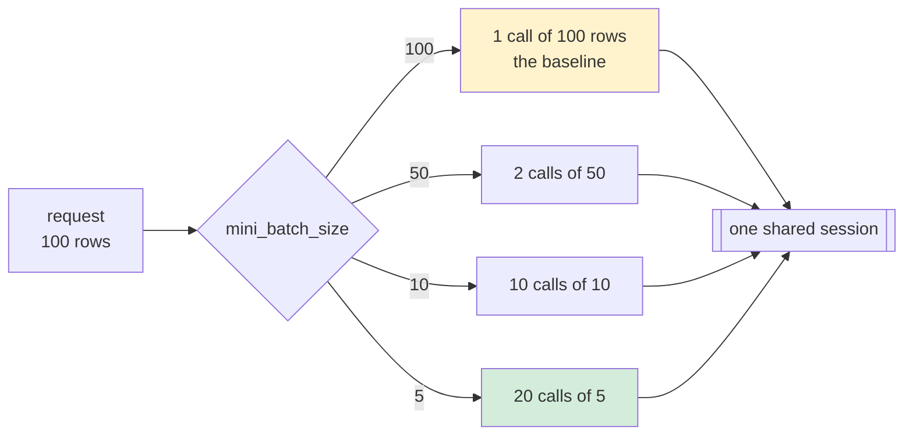

# minibatch-size-cpu-c9g-10M-20M — runbook

## The question

At a fixed offered load, which `mini_batch_size` is fastest — on one `c9g.16xlarge`, with
idle threads asleep, with one request in five written to S3, at two model weights and two
request sizes?

`minibatch-rows-cpu-arm64-10M` answered a neighbouring question with 4 sessions of 16
threads, spinning **on**, the log **off**, and only 4/8/16 tried. Four settings differ, so
the optimum here is measured rather than inherited.

## One knob moves inside a comparison group

A group is `(model, rows, tps, sessions)` and its members differ only in `mini_batch_size`.
The largest member is `mini_batch_size == rows` — one engine call per request, and the
baseline the rest are read against. Each group also carries one cell that configures **no
mini batch at all**, which prices the split path's own overhead.



## Two settings this round had to get right, and why they are not obvious

### `sessions_per_model` is a request count, not a pool width

A request leases a session group **exclusively** while it scores, so the server's
throughput ceiling is `sessions / service_time`. At `sessions=1` a probe measured **103
req/s against 250 offered** — every cell would have been a measurement of queueing. This
round measures 4 and 8, which both admit every lane's load with room to spare, and makes
the session count a second axis rather than a pinned value.

### `concurrency_per_session` had to be added to hushar

`session_profile` derived a session's mini-batch overlap as `cores / intra_op_threads`,
and `ExecutionPlan::resolve` refuses a split unless that exceeds 1. That coupled two
unrelated decisions:

| intra width | overlap derived | consequence |
|--:|--:|---|
| 16 | 4 | a 20-piece request runs 5 waves deep |
| 64 | 1 | the split is **refused at startup** |

A probe at width 16 showed the cost is not mild: every cell with more pieces than the
ceiling **collapsed** — 107 of 250 req/s at 4.8 s, on 31% of the host — because the rayon
fan-out pool is sized from the same figure and was 3 threads wide.

`threading.concurrency_per_session` (commit `66bae08e`) sets it directly. It is held at
**64** across the whole grid, so every cell's pieces overlap whatever the width and the
mini-batch size is the only variable in a group. `ExecutionProfile` keeps the derived
figure as `parallel_mini_batches`, so the banner reports how much of the overlap is real
and how much time-slices the pool.

## The rig: four lanes, one comparison group each

| lane | server | client | model | load | cells |
|---|---|---|---|--:|--:|
| 1 | `c9g-1` | `cl1` | 10M | 100 x 250 | 14 |
| 2 | `c9g-2` | `cl2` | 10M | 500 x 50 | 14 |
| 3 | `c9g-3` | `cl3` | 20M | 100 x 100 | 14 |
| 4 | `c9g-4` | `cl4` | 20M | 500 x 20 | 14 |

A lane owns one model at one request size, so its four mini-batch sizes at both session
counts, its two unsplit references and its noise-floor repeats are all on **one machine**.
The 10M CPU campaign measured a placement offset between two instances of the same type
that repeating does not reduce. Two readings do cross hosts and the report names them: the
packaging one (100 x 250 against 500 x 50, both 25,000 rows/s) and 10M against 20M.

All eight hosts go in **one availability zone**; `rig.py launch` picks the first zone that
can hold the servers.

## Run it

Everything is detached and resumable. The laptop may be closed for the whole run: each cell
goes to S3 as it completes, and re-running a lane skips whatever S3 already holds.

```bash
cd benchmark-data/private/minibatch-size-cpu-c9g-10M-20M/driver
export AWS_PROFILE=hushar-bench AWS_DEFAULT_REGION=us-west-2
export HUSHAR_BENCH_BUCKET="hushar-bench-$(cat ../../../../.account-ids)-us-west-2"
. "$(conda info --base)/etc/profile.d/conda.sh" && conda activate local
```

### 0 · before anything launches

```bash
./dryrun.py          # must print `0 failures`
./gridcheck.py       # the 56 cells, and what the rig is being asked to buy
```

### 1 · package  (~3 min)

```bash
./package.sh         # prints REV= and MD5_10m= / MD5_20m= -- export REV
```

### 2 · launch the rig and install keys  (~6 min)

```bash
python rig.py launch     # refuses an AMI older than 45 days
python rig.py status
python keys.py           # one ephemeral keypair per lane
```

Eight instances: four `c9g.16xlarge` servers, four `m9g.8xlarge` clients, no public
address, no key pair. Ids land in `rig-state.json` (gitignored).

### 3 · deploy  (~12 min, two calls because the lanes differ in model size)

```bash
python fanout.py c9g-1,c9g-2,cl1,cl2 -f deploy.sh --timeout 2400 \
  --env REV=$REV --env MODEL_SIZE=10m --env MODEL_MD5=$MD5_10m \
  --env HUSHAR_BENCH_BUCKET=$HUSHAR_BENCH_BUCKET

python fanout.py c9g-3,c9g-4,cl3,cl4 -f deploy.sh --timeout 2400 \
  --env REV=$REV --env MODEL_SIZE=20m --env MODEL_MD5=$MD5_20m \
  --env HUSHAR_BENCH_BUCKET=$HUSHAR_BENCH_BUCKET
```

### 4 · prove the configuration on one short cell  (~8 min)

Worth the eight minutes every time. This round's smoke cell caught three faults that would
each have cost the whole grid: a wrong plan-name assertion, slices read from the wrong
file, and `sessions=1` being unservable.

```bash
RIG=$(python rig_env.py)
python fanout.py cl1 -f launch.sh --timeout 300 \
  --env REV=$REV --env RUN=minibatch-size-cpu-c9g-smoke \
  --env MODEL_SPECS="10m:$MD5_10m" --env RIG="$RIG" --env SERVER_FOR=c9g-1 \
  --env LOADS=100x250 --env MINI_BATCHES='100=5' \
  --env WARMUP=20 --env DURATION=60 --env SEGMENTS=2 --env SETTLE=5 \
  --env MAX_CELLS=2 --env LANE_TAG=smoke \
  --env HUSHAR_BENCH_BUCKET=$HUSHAR_BENCH_BUCKET
```

### 5 · the grid  (~5.2 h, detached)

```bash
RIG=$(python rig_env.py)
lane() { python fanout.py "$1" -f launch.sh --timeout 300 \
  --env REV=$REV --env MODEL_SPECS="$3:$4" --env RIG="$RIG" \
  --env SERVER_FOR="$2" --env LOADS="$5" \
  --env HUSHAR_BENCH_BUCKET=$HUSHAR_BENCH_BUCKET; }
lane cl1 c9g-1 10m $MD5_10m 100x250
lane cl2 c9g-2 10m $MD5_10m 500x50
lane cl3 c9g-3 20m $MD5_20m 100x100
lane cl4 c9g-4 20m $MD5_20m 500x20
```

Then stop looking at it. `./watch.sh` reads the bucket alone and makes no SSM call. A lane
is finished when its log says `lane complete`.

### 6 · collect, scrub, report, verify — **in this order**

```bash
python collect.py            # S3 -> raw/, plus CloudWatch per cell
./scrub.py                   # report what would be masked
./scrub.py --apply           # mask it, BEFORE the report is generated
./report.py                  # summary.md
./verify.py                  # must print `0 failures`
python ../../../../scripts/check_privacy.py
```

The order is load-bearing. `scrub.py` must run after `collect.py`, because the archived
server logs and service configurations arrive from the host naming the bucket, and before
`report.py`, so the summary is generated from already-masked inputs.

### 7 · tear it down

```bash
CONFIRM=terminate python rig.py terminate
aws s3 rm "s3://$HUSHAR_BENCH_BUCKET/inference-logs/minibatch-size-cpu-c9g-10M-20M/" \
  --recursive
```

Terminate rather than stop: a stopped instance keeps the kernel it was launched with, which
is how an earlier rig came to be flagged for an outdated OS. The inference-log objects are
~237 GiB and are not evidence the report reads — only the latency they cost is.

## Knobs

| variable | default | what it does |
|---|---|---|
| `SESSIONS` | `8,4` | session counts to measure, as a list. The second axis |
| `INTRA` | `cores / sessions` | intra-op width per session. Overriding breaks the budget rule |
| `CONCURRENCY_PER_SESSION` | `64` | mini batches in flight on one session. Held constant |
| `MINI_BATCHES` | per row count | e.g. `'100=100,50,10,5;500=500,100,50,10'` |
| `LOADS` | per model size | e.g. `'100x250,500x50'` |
| `REFERENCE` | `1` | add the `whole request` cell per group |
| `REPEATS` | `2` | extra measurements of one configuration, for the noise floor |
| `SAMPLE_RATE` | `0.2` | inference-log sampling |
| `WARMUP` `DURATION` `SEGMENTS` `SETTLE` | `300` `900` `15` `60` | the window |
| `MAX_CELLS` | `0` | smoke testing only |

`launch.sh` forwards each of these as an **empty** string when it is not overridden, so
`sweep.py`'s own default applies. Every knob is therefore read through `env()`, which
treats set-but-empty as absent — `os.environ.get(name, default)` does not, and `int("")`
raises at import. `dryrun.py` gates that.

## Known limits

- **The axis never turned over.** The smallest mini batch won in all eight groups, so the
  optimum may lie below 5 rows at 100 and below 10 at 500. A follow-up should extend the
  axis downward rather than treat 5 and 10 as optima.
- **Two readings cross hosts**: packaging (100 x 250 against 500 x 50) and 10M against
  20M. Both are ratios several times larger than the few percent a placement offset
  contributes, but neither is a within-host comparison.
- **`parallel_mini_batches` is a host derivation, not a measurement.** It says how many
  pieces reach distinct cores; it does not say what the surplus cost. The report carries
  the figure and the `time_sliced` flag, not an attribution.
- **One cell is `partial`** — the unsplit reference at 10M 100 x 250 with 4 sessions held
  12 of 15 slices. That load is at the host's edge without a split, which is itself a
  finding, but it means that group's `gain vs none` has no denominator.
- **The log at 0.2 is not isolated.** Every cell logs, so this round cannot say what
  logging costs. A third round at `sample_rate` 0.0 on the same grid would price it.
