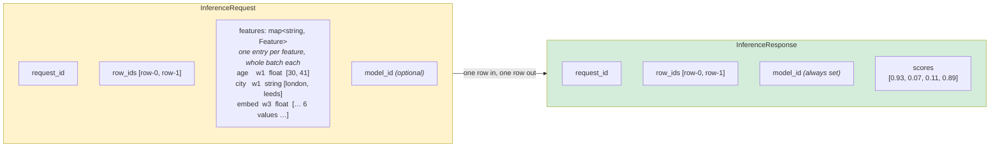

# The API

One RPC, one request message, one response message.

```protobuf
service Hushar {
  rpc InferenceService (InferenceRequest) returns (InferenceResponse);
}
```

Anything that speaks protobuf can build the payload, in any language with a generated
client and nothing else to install. The definitions are the source of truth and live in
[`schemas/protos`](../schemas/protos/structs.proto); this page is why they have the shape
they do.



---

## There is no tensor on the wire

A caller sends values with names. A configuration file, checked against the model at
startup, says how they become model inputs. That single decision is what the rest of this
page follows from.

## Features are a map, not a list

`map<string, Feature>`, one entry per feature, each carrying that feature's values for the
whole batch.

| Consequence | Why it matters |
|---|---|
| A name travels once per request | at 100 rows over 210 features that is 210 names instead of 21,000 |
| A name cannot be sent twice | the map key enforces it, so there is no ambiguity to resolve |
| Position carries no meaning | `feature_order` in the model configuration decides where a feature lands |

Most features are one scalar each, and the full width only exists after the
transformations, so above a few rows the named form is smaller on the wire than the tensor
it concatenates into. Below that it is larger, since the field headers are paid per request
rather than per row.

## One type per feature

A `Feature` is a `oneof`, so an entry is one array of one type.

| Variant | Element type |
|---|---|
| `float_values` | `float` |
| `double_values` | `double` |
| `integer_values` | `int32` |
| `long_values` | `int64` |
| `string_values` | `string` |

Strings reach the model as numbers or not at all: every feature is transformed before it
is concatenated, which is also why a provider that cannot hold a string element never
sees one. [configuration.md](configuration.md#feature-transformations) lists the
transformations.

## Width is stated by the caller and required by the model

These are two different checks, deliberately, so a failure can say which one it was.

| Check | Source | Failure says |
|---|---|---|
| values sent match the stated `width` | the request itself | which feature contradicted itself |
| width the model needs | the model configuration | which feature the model disagrees with |

`width` is values per row. `0` means "not stated", and then only the weaker check applies:
the value count must divide by the row count. Values are row-major, so an entry holds
`rows * width` of them.

## Rows

`row_ids` is one id per row, in row order, and **its length is the row count** every entry
is measured against. The response returns the same ids in the same order.

A feature the batch has no value for is left out of the map entirely, and its
transformation's default covers it. Omission is the way to say "absent"; an empty array is
not.

## The response

One score buffer for the whole batch, not one per row. Row `r` begins at `r * width`, where
`width` is `values / rows`, so no shape can disagree with the values it describes.

`scores` is a `oneof` over `FloatArray` and `DoubleArray`, so a model asked for double
precision is not narrowed on the way out. Only the model's **first output** is returned:
class probabilities, a regression value, a forecast horizon or an embedding.

## Choosing the model

| `model_id` in the request | What happens |
|---|---|
| empty | the server applies the traffic split from its configuration |
| a loaded id | that model serves the request |
| anything else | an error, never a fallback |

An unknown id failing rather than falling back is what lets a caller run its own split
without the risk of being served the other arm. `model_id` is always set in the response,
because the server may be the one that chose it. See
[configuration.md](configuration.md#candidate-model).

## Already vectorized?

That is the ordinary case and it needs no special path: send the vector as one entry of
that width, give it an `identity` transformation that wide, and it reaches the model
unchanged.

## What gets logged

`InferenceLogBatch` is the request's shape with the scores added, so writing a log is a
move rather than a rebuild. The features in it are **as the caller sent them**, before any
transformation: the named values, not the vectorized input the model saw. Feature logging
can be turned off, and then that map is empty.

Read a written log back with:

```bash
cargo run -p benchmark-client --example inspect_log -- ./logs
```

## Next

| Want to | Read |
|---|---|
| map features to model inputs | [configuration.md](configuration.md#vectorization_config) |
| follow one request through the server | [request-walkthrough.md](request-walkthrough.md) |
| send a first request | [quickstart-cpu.md](quickstart-cpu.md#5--send-a-request) |
