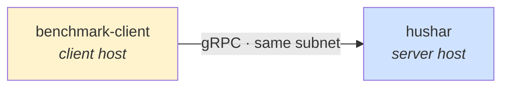
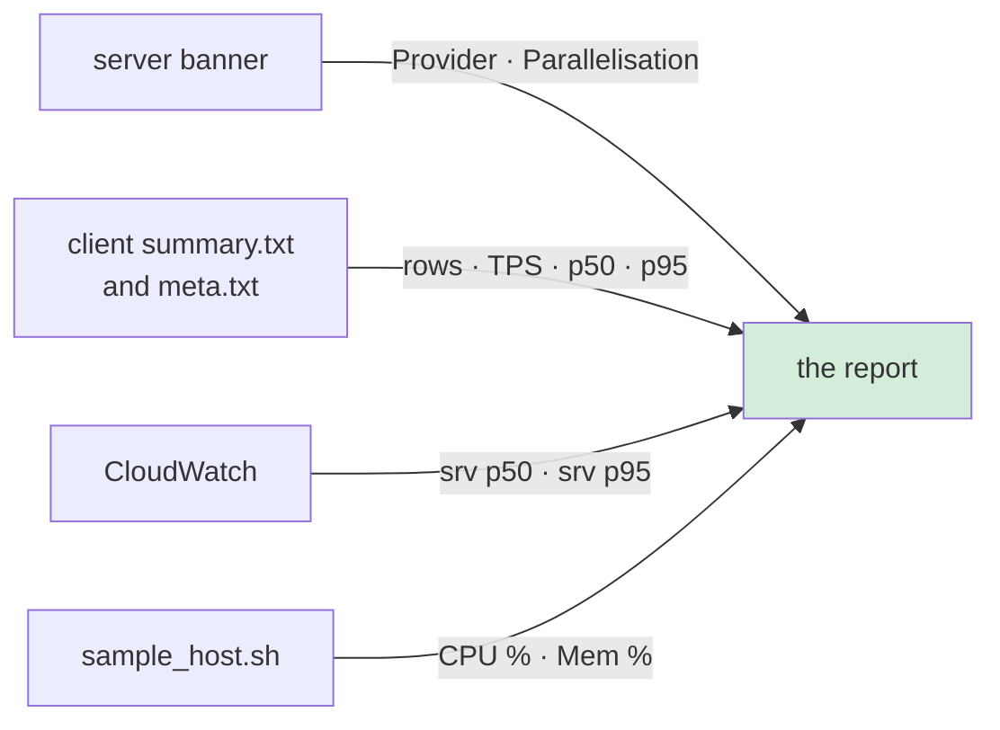

# Benchmarking

Two hosts in the same subnet: the client offers a fixed rate, the server is under test.



Run everything from the repository root, or from the unpacked bundle root.

## 1 · Package — laptop

```bash
python scripts/generate_benchmark_models.py     # once
scripts/benchmark/package.sh                    # source, scripts, configurations
```

Models are not in the bundle. Stage them once and pull on each server host:

```bash
aws s3 sync benchmark-data/generated s3://my-bucket/hushar-bench/generated/
# server host:
aws s3 sync s3://my-bucket/hushar-bench/generated/ benchmark-data/generated/
```

## 2 · Upload

```bash
BUNDLE=$(ls -t benchmark-data/dist/*.tgz | head -1)
for host in "$SERVER_HOST" "$CLIENT_HOST"; do
  scp "$BUNDLE" "$host":~/ && ssh "$host" "tar xzf $(basename "$BUNDLE")"
done
```

Open the server's port — 8279 by default — to the client's security group.

## 3 · Bootstrap — once per host

```bash
cd hushar-bench-<sha>
scripts/benchmark/bootstrap.sh --role server --provider cpu
scripts/benchmark/bootstrap.sh --role server --provider neuron  # on a Neuron DLAMI
scripts/benchmark/bootstrap.sh --role client                    # no engine on the client
```

The server host needs credentials that allow `cloudwatch:PutMetricData` — an instance role
is easiest — or the server-side percentiles cannot be collected. Nothing else to install:
the CPU and memory sampler reads `/proc`.

| `--provider` | Runtime |
|---|---|
| `cpu` *(default)* | `onnxruntime-linux-{x64,aarch64}` |
| `tensorrt` | `onnxruntime-linux-x64-gpu_cuda12` |
| `xnnpack`, `openvino` | build with `scripts/benchmark/build_ort.sh`, then set `ORT_DYLIB_PATH` and `LD_LIBRARY_PATH` |
| `neuron` | `libnrt.so.1` and the Neuron driver supplied by a Neuron DLAMI |

For ONNX Runtime, `--provider` is also a Cargo feature. Neuron is a separate engine and is
compiled into the default hushar binary; runtime availability is checked when a NEFF loads.

### Compile a Neuron model

Neuron does not compile ONNX directly. On a Neuron 2.31 PyTorch DLAMI, rebuild the same
seeded vectorized benchmark architecture and retain the NEFF from `torch_neuronx.trace`:

```bash
source /opt/aws_neuronx_venv_pytorch_2_9/bin/activate
python scripts/benchmark/compile_neuron.py --params 10M --batch-size 50
python scripts/benchmark/compile_neuron.py --params 50M --batch-size 100
```

A NEFF has a fixed leading dimension. Compile each batch size the run needs and keep the
written metadata JSON with the result; it records the hash, versions, shape, parameter
count, and compiled-versus-PyTorch error.

## 4 · Run

```bash
# server host — starts once, serves the whole sweep
MODEL=transformer-ab PROVIDER=cpu WORKER_THREADS=24 SESSIONS=8 THREADS=21 \
  CW_NAMESPACE=HusharBench \
  scripts/benchmark/run_server.sh start

# Neuron — two one-core replicas on trn1.2xlarge, fixed batch 50
MODEL=transformer PROVIDER=neuron SESSIONS=2 WORKER_THREADS=4 \
  MODEL_CONFIG=benchmark-data/generated/bench_model_neuron_10m_b50_config.json \
  NEFF_PATH=benchmark-data/generated/bench_model_neuron_10m_b50.neff \
  MINI_BATCH_SIZE=50 MINI_BATCH_FIXED=1 NEURON_EXECUTION_CONTEXTS=1 \
  CW_NAMESPACE=HusharBench \
  scripts/benchmark/run_server.sh start
```

Every arm takes one concatenated FP32 input the service builds, so every arm runs on any
provider — a device provider and an accelerator included. That is what makes the GPU and
Neuron sweeps comparable with the CPU ones: the model signature does not change with the
hardware.

Read the banner: it names the provider **actually registered** or the libnrt version and
NeuronCore range, plus the concurrency and admission limit. Those lines are the report's
`Provider` and `Parallelisation` columns, so keep them.

For Neuron, `SESSIONS` means model replicas rather than ORT sessions. On a two-core
`trn1.2xlarge`, `SESSIONS=2` with one core per replica occupies both cores.
`NEURON_EXECUTION_CONTEXTS` controls concurrent tensor sets inside each replica and matters
when one request is split into several NEFF-sized pieces. `THREADS`, `INTER_THREADS`,
`ALLOW_SPINNING`, and `ORT_SESSION_CONFIG` are ORT-only.

`CW_NAMESPACE` is what makes the report's **server-side** percentiles possible: timings go
to CloudWatch as one data point per scored batch, and CloudWatch holds the distribution.
Without it timings only reach the server log, which carries means and no percentiles.

An execution provider that brings a thread-pool of its own — XNNPACK, OpenVINO — wants the
opposite arrangement, and `ALLOW_SPINNING=0` so ONNX Runtime's idle threads sleep rather
than competing with it. The banner reports spinning whenever it is configured, so a report
can say which was measured:

```bash
MODEL=transformer-ab PROVIDER='openvino:CPU:threads=21:streams=1' \
  WORKER_THREADS=24 SESSIONS=8 THREADS=1 ALLOW_SPINNING=0 \
  LABEL=c8i-openvino \
  CW_NAMESPACE=HusharBench \
  LOG_URI=s3://my-bucket/inference-logs \
  scripts/benchmark/run_server.sh start
```

`LABEL` names the run's files, which a provider string carrying options otherwise makes
unwieldy. `LOG_URI` puts rows in S3, so the measurement exercises the paths a deployment
actually uses and the results outlive the instance.

```bash
# server host — one sampler covers the whole sweep, for the CPU % and Mem % columns
scripts/benchmark/sample_host.sh start
```

The sampler's CPU figure is the scheduler's own run-time counter (`/proc/schedstat`), not
the tick-based `/proc/stat` columns: on a tickless kernel a busy CPU whose tick has stopped
can be accounted as idle for a whole window, which is how several cells in the 16xlarge runs
read under 0.1 % CPU while serving their full rate. Each sample also carries the `/proc/stat`
figure as a sixth column, so the two can be compared over any window; `report` prints both.

```bash
# client host
SERVER=http://10.0.1.23:8279 MODEL=transformer TPS="100 200 300" \
  DURATION=45 WARMUP=15 ROWS=100 scripts/benchmark/run_client.sh
```

The client is told the **control arm's** model, so a `transformer-ab` server is driven
with `MODEL=transformer` — every arm takes the same features. Sweep until something sheds,
then stop: the last rate with `shed = 0` and `achieved ≈ offered` is the answer.

Note the wall-clock time the sweep started and ended; §6 needs it to cut the CloudWatch
window to the measured part.

## 5 · Collect

```bash
# server host
scripts/benchmark/sample_host.sh stop
scripts/benchmark/run_server.sh stop
scripts/benchmark/hostinfo.sh > /tmp/hushar-server/hostinfo.txt

# laptop
scp -r "$SERVER_HOST":/tmp/hushar-server ./
scp -r "$CLIENT_HOST":/tmp/hushar-client/<label> ./

STEM=c9g-48xlarge-cpu-2026-09-11
aws s3 sync /tmp/hushar-client/<label>/ "s3://my-bucket/hushar-bench/$STEM/client/"
aws s3 sync /tmp/hushar-server/         "s3://my-bucket/hushar-bench/$STEM/server/"
```

## 6 · Record

One directory per run under `benchmark-data/results/`, named for what the run swept — a
multi-host run is not named after one host:

```text
benchmark-data/results/<bench-name>/
├── summary.md          # the report, generated from raw/results.json
└── raw/
    ├── README.md       # what each file is, and anything deliberately left out
    ├── results.json    # every cell, enriched; the only input the report reads
    ├── cells/          # one original JSON record per cell, written the moment it finished
    ├── server/<host>/  # banners, resolved configurations, per-second host samples
    ├── client/<host>/  # load-generator output and client host samples
    ├── driver/         # the exact scripts that ran, lane logs, report generator, verifier
    ├── model-config.json, model-metadata.json, environment.json, run-status.json
```

`results/` carries one round at a time. The first round of benchmarking swept every threading
permutation on every accelerator and recorded all of it — 69 MB across 6,539 files — which
left a reader more evidence than insight and went stale the moment the service's own
numbers moved. Those campaigns are now in `benchmark-data/old-results/`, present on disk
and untracked, so a figure can still be looked up without the repository carrying a round
it is no longer making a case with. Record the new round here, one run at a time, and
**earn each one**: a run belongs in `results/` when its report answers a question a reader
actually has, not because the cells were collected.

Collect every cell in the session that measured it; a host's `/tmp` does not survive a
reboot. Keep the same evidence in S3 under a prefix named for the run.

**Write the report for someone reading it for the first time.** Describe a cell by its
settings — shape, spinning policy, worker threads, load — in the table itself, never by the
driver's phase letter, which belongs in `raw/README.md` as a decoder for cell IDs. Lead with
the answer, then the like-for-like comparison, then the diagnostics, then what it means, the
caveats, and how it was measured. A cell sustains only when achieved TPS is within 2 % of
offered with nothing shed and nothing failed; print an unsustained cell as `✗ <achieved TPS>`
and never rank its latency or substitute a lower rate. State the spinning policy each stack
*actually* ran — Triton's onnxruntime backend ignores the `config.pbtxt` spinning keys — and
name what CPU and memory measure. Leave one blank line before and after every table.

**Generate and verify, do not hand-edit.** `raw/driver/report.py` writes `summary.md` from
`results.json` deterministically; `raw/driver/verify.py` re-derives every displayed figure
from the original cell records and sample logs, checks the settings columns against the
resolved server configurations, checks the lane logs completed, and fails on any
disagreement. Both are committed beside the evidence so the report can be regenerated.

A bucket name embeds an AWS account number, so pass it in rather than committing it, and check
before you commit — an account id travels by paste, inside a path nobody reads twice:

```bash
echo <account-id> > .account-ids        # untracked; or export HUSHAR_ACCOUNT_IDS
python3 scripts/check_privacy.py        # non-zero if a tracked file carries an id or credential
```

The accounts in use are checked exactly, which catches an id concatenated into a longer name —
`bucket<account-id>logs` — that the generic twelve-digit pattern steps over. The list stays out
of the repository, because an id committed to teach a scanner about it has still been committed.
This paragraph is why it is spelt `<account-id>` here too.

Four sources feed a report's columns:



```bash
# srv p50/p95 — µs in CloudWatch, ms in the report, averaged over the arms
START=2026-09-10T18:00:00Z END=2026-09-10T18:45:00Z \
  scripts/benchmark/server_latency.sh HusharBench bench-vectorized bench-vectorized-candidate

# CPU % and Mem % — per rate, in seconds from the first sample
scripts/benchmark/sample_host.sh report 0 45     # the first rate
scripts/benchmark/sample_host.sh report 45 90    # the second
```

Both windows matter. `START`/`END` cut CloudWatch to the measured sweep rather than
including the warmup and the idle tail; `report <from> <to>` does the same for the host
samples, in seconds from the first sample so no clock arithmetic is needed.

Then fill the table from `summary.txt` and commit.

## When it goes wrong

| Symptom | Cause |
|---|---|
| client cannot connect | port not open to the client's security group, or the server bound `127.0.0.1` |
| `failed > 0` | not a capacity finding — read the server log |
| everything sheds, latency flat | the **client** is the bottleneck; use a bigger client host |
| server will not start | `ORT_DYLIB_PATH` unset or wrong, or the model is missing |
| provider in the banner is not the one you asked for | the host's `libonnxruntime` lacks it |
| first rate much slower than the second | raise `WARMUP` |
| `build.rs` fails on the instance | `protoc` missing — `--skip-packages` does not install it |
