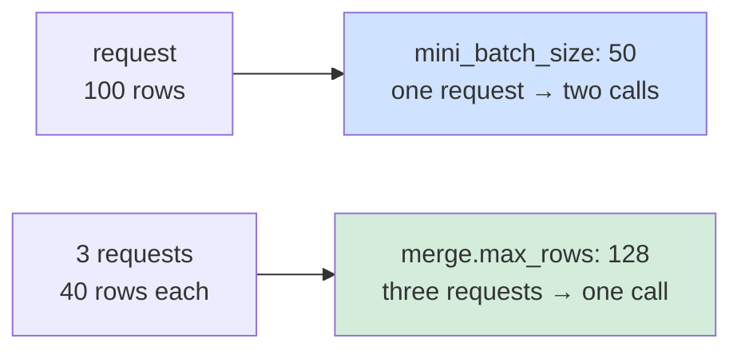

# Configuration

Hushar loads configuration in this order:

```text
--config-uri → service.json → model.json → model artifact
```

`service.json` configures the process. `model.json` configures one model and its backend.
Both support local paths, `file:///` URIs, and `s3://` URIs.

Unknown fields are rejected throughout the configuration hierarchy, except inside an
individual feature transformation payload.

## Minimal example

`service.json`:

```json
{
  "model_config_path": "model.json",
  "inference_log": { "uri": "./logs" }
}
```

`model.json` for an ONNX model with one FP32 input of width two:

```json
{
  "model_id": "model-v1",
  "model_path": "model.onnx",
  "vectorization_config": {
    "feature_order": ["age", "amount"]
  }
}
```

Start Hushar with `--config-uri service.json` or set `HUSHAR_CONFIG_URI`.

## CLI and paths

| CLI flag | Environment variable | Meaning |
|---|---|---|
| `--config-uri` | `HUSHAR_CONFIG_URI` | **required** path or URI to `service.json` |
| `--port` | `HUSHAR_PORT` | overrides `service.json.port_number` |
| `--bind-address` | `HUSHAR_BIND_ADDRESS` | overrides `service.json.bind_address`; must be an IP address |

| Form | Supported for | Example |
|---|---|---|
| local path | configuration, models, logs | `./config/service.json` |
| `file:///absolute/path` | configuration, models, logs | `file:///opt/hushar/model.onnx` |
| `s3://bucket/key` | configuration, models, logs | `s3://my-bucket/models/model.onnx` |

A `file://` URI must contain an absolute path. Unknown URI schemes fail at startup.

## `service.json`

| Field | Required | Default | Meaning |
|---|---:|---|---|
| `model_config_path` | yes | — | control model configuration path or URI |
| `inference_log` | yes | — | sampled inference-log destination |
| `threading` | no | field defaults | admission, workers, backend copies, and ORT tuning |
| `candidate_model` | no | none | optional candidate model and traffic percentage |
| `bind_address` | no | `0.0.0.0` | listener IP address |
| `port_number` | no | `8279` | listener port |
| `metrics` | no | stderr | latency metrics destination and batching |

### Inference logging

`inference_log` is required so disabling or sampling prediction records is an explicit
decision.

| Field | Required | Default | Constraint |
|---|---:|---:|---|
| `uri` | yes | — | local path, `file:///`, or `s3://` |
| `batch_size` | no | `5000` | greater than zero |
| `sample_rate` | no | `1.0` | finite value from `0.0` to `1.0` |
| `max_sends_in_flight` | no | `4` | `1..=u32::MAX` |
| `prefix_shards` | no | `16` | greater than zero |

Sampling is per request. `0` disables sampling; other values are rounded to a one-in-N
cadence, and the startup banner prints the effective rate.

<a id="log-object-keys"></a>
#### Where a log object lands

One object per `batch_size` batches, keyed by shard and then by time:

```
s3://my-bucket/inference-logs/shard=07/year=2026/month=10/day=05/hour=02/mi=31/<uuid>_<micros>.pb
└──────────── uri ───────────┘└ shard ┘└───────── when it was written ────────┘└──── unique ────┘
```

The shard leads because S3 scales its request rate **per key prefix** and splits a hot
prefix only after it has observed the load. Without it, a whole fleet writing in the same
minute shares one rate limit and can be throttled while that split happens. `16` prefixes
give sixteen times the headroom immediately; raise it for a large fleet, or set `1` to
write everything beneath one prefix.

It is spelled `shard=07` rather than `07` so the keys stay Hive-partitioned: discovery
stops at the first level that is not `key=value`, so a bare segment would take `year=`
and everything below it out of the table. In Athena or Glue, `shard` becomes one more
partition column — declare it and ignore it, or project it over `0`..`prefix_shards - 1`.

### Metrics

| Field | Required | Default | Constraint |
|---|---:|---:|---|
| `cloudwatch_namespace` | no | unset → stderr | when set, must contain a non-whitespace character |
| `batch_size` | no | `500` | greater than zero; CloudWatch caps the effective value at `333` |
| `max_sends_in_flight` | no | `4` | `1..=u32::MAX`; used only by CloudWatch |
| `detailed` | no | `false` | publish the scheduling measures as well as the three stage timings |

CloudWatch metrics include a `ModelId` dimension. Namespace permissions are checked when
metrics are published, not at startup.

#### What a request reports

Three measures are published always. `detailed` adds six more, and **triples the data
points each request emits**, which is why it is off by default: the metric path has been
observed to drop batches at the smaller volume under heavy load.

| Measure | Unit | Detailed | Meaning |
|---|---|:-:|---|
| `VectorizationTime` | µs | | building the model's input from the request's features |
| `ToTensorTime` | µs | | handing that input to the backend |
| `InferenceTime` | µs | | the engine call. Across mini batches, the **longest single call** |
| `RequestTime` | µs | ● | the request's own span, start to scores |
| `LeaseWaitTime` | µs | ● | waiting for a session; `0` on a merged request |
| `EngineCalls` | count | ● | engine calls the request became |
| `BallastRows` | count | ● | rows computed and discarded to fill a fixed call shape |
| `CallFillPercent` | percent | ● | real rows as a share of the rows sent to the engine |
| `QueueDepth` | count | ● | requests waiting when this one joined a merge queue |

`InferenceTime` is a **critical path, not device work**: when mini batches overlap, or when
a call is shared between merged requests, no part of that call's duration belongs to one
request. `RequestTime` is the figure to compare against a client-side latency.

#### Reading fill and ballast

These two tell you whether a merge configuration is earning its keep. The same model under
two windows, serving 60 req/s of 40-row requests into `max_rows: 256`:

| `max_delay_micros` | `CallFillPercent` | `BallastRows` | `RequestTime` |
|---:|---:|---:|---:|
| 500 | 15% | 216 | 1.1 ms |
| 20000 | 30% | 178 | 13.6 ms |

Waiting 40× longer doubled the fill and cost 12× the latency, and even then 70% of every
call was ballast. That is a `max_rows` far too wide for this load: the right move is a
smaller call, not a longer wait. Without these two measures the configuration looks fine,
because latency and throughput both hold.

<a id="what-the-observability-levers-cost"></a>
### What the observability levers cost

| Setting | Lower value | Higher value |
|---|---|---|
| `sample_rate` | less log work and data | more complete inference records |
| `batch_size` | more sends, less buffering | fewer sends, more buffering |
| `max_sends_in_flight` | earlier shedding under sink pressure | more concurrent sends and memory use |
| `prefix_shards` | fewer S3 prefixes, fewer query partitions | more write headroom per prefix |

### Candidate model

| Field | Required in `candidate_model` | Constraint |
|---|---:|---|
| `config_path` | yes | non-empty path or URI to another `model.json` |
| `traffic_percent` | yes | whole number from `0` to `100` |

The control and candidate must have different `model_id` values. A request with no model
ID follows the arrival-order traffic split; an explicit loaded ID selects that model, and
an unknown ID fails. Each model has its own artifact and vectorization configuration.

<a id="threading"></a>
### Threading

| Field | Scope | Default | Constraint / meaning |
|---|---|---:|---|
| `connection_concurrency` | all | `500` | greater than zero; in-flight requests **per connection** |
| `worker_threads` | all | available host parallelism | greater than zero; async service work, not inference |
| `sessions_per_model` | all | `1` | greater than zero; ORT sessions or Neuron replicas per model |
| `intra_op_threads` | ORT | `1` | non-negative; `0` leaves the ORT choice unset |
| `inter_op_threads` | ORT | unset | non-negative; a value above `1` requires `intra_op_threads: 1` |
| `allow_spinning` | ORT | unset | preserves ORT behavior when omitted |
| `session_config` | ORT | `{}` | string settings passed to ONNX Runtime |

`session_config` keys must be non-empty, contain no whitespace, and be at most 128 bytes;
values may be at most 1024 bytes. Do not set ORT spinning entries in `session_config` when
`allow_spinning` is also set.

#### Sessions and request lanes

One session serves one request at a time, so `sessions_per_model` is both the model copies
loaded and the requests that can score at once:


Raising it buys throughput at one model copy and one thread pool each. For ONNX Runtime the
CPU load is `sessions_per_model × intra_op_threads`, so the two are chosen together — see
[threads-and-cores.md](threads-and-cores.md) for tuning guidance.

ORT-only fields have no effect on a Neuron-only deployment.

## `model.json`

| Field | Required | Default | Meaning |
|---|---:|---|---|
| `model_id` | yes | — | identifier returned in responses, logs, metrics, and banners |
| `model_path` | yes | — | local path or URI to the model artifact |
| `backend` | no | ONNX Runtime CPU | explicit backend configuration |
| `execution_provider` | no | `cpu` | legacy top-level ORT provider; cannot be combined with `backend` |
| `mini_batch_size` | no | unset | positive row count for splitting requests into model calls |
| `is_fixed` | no | `false` | pads the final mini-batch; requires `mini_batch_size` when true |
| `merge` | no | unset | merge rows across requests into one call; cannot be combined with `mini_batch_size` |
| `vectorization_config` | yes | — | maps request features to model inputs |

The backend is selected by configuration, not by the model filename.

### Mini-batching or merging, never both

`mini_batch_size` and `merge` are opposite moves, so a model configures one or the other:



Merging fills a call so its fixed cost is spread over more rows. A mini batch divides a
call and pays that cost again per batch. Setting both is refused at startup:

```text
model "m" sets both "mini_batch_size" and "merge", which are opposite moves: merging fills
one call from several requests so its fixed cost is spread over more rows, and a mini batch
cuts one request up and pays that cost again per batch. Keep "mini_batch_size" to split
requests, or keep "merge" to fill calls from them.
```

A mini batch is also refused on a backend whose concurrent calls queue on a device, unless
the model's own graph demands that row count. See
[hardware.md](hardware.md#mini-batching-on-a-device-provider).

<a id="merge"></a>
### `merge`

| Field | Required | Default | Meaning |
|---|---:|---|---|
| `max_rows` | yes | — | rows in one engine call; greater than zero |
| `max_delay_micros` | no | `0` | how long a call waits for more requests before running short |

```json
"merge": { "max_rows": 256, "max_delay_micros": 300 }
```

Rows from concurrent requests are collected into one call, and each caller gets its own
rows back:

```mermaid
flowchart LR
  a["request A<br/>100 rows"] --> q[["queue"]]
  b["request B<br/>80 rows"] --> q
  c["request C<br/>40 rows"] --> q
  q --> call[["one call<br/>256 rows<br/>36 ballast"]]
  call --> sa["A's 100 scores"]
  call --> sb["B's 80 scores"]
  call --> sc["C's 40 scores"]
  style call fill:#cfe2ff
```

Three things to know before setting it:

- **Every call is padded to exactly `max_rows`.** The engine is always shown one shape, so
  a provider that compiles per shape builds one engine instead of one per observed width.
  A call that is not full computes ballast rows and throws their scores away.
- **`max_delay_micros` is added to the latency of whichever request arrives first.** The
  default of `0` never waits: it takes whatever is already queued. That is safe to enable
  but merges nothing under light load, which is when merging has least to offer anyway.
- **A request larger than `max_rows` spans consecutive calls.** Its rows still come back
  in order. That is the cap doing its job, not mini batching.

A pinned graph or a NEFF loads against `max_rows`, since a merged call always presents
that many rows. A `max_rows` that disagrees with a pinned leading axis is refused when the
model loads.

### ONNX Runtime backend

Use either the explicit form:

```json
"backend": {
  "type": "onnxruntime",
  "execution_provider": "cpu"
}
```

or the legacy form:

```json
"execution_provider": "cpu"
```

Do not use both. The provider must be supported by the linked ONNX Runtime library; see
[hardware.md](hardware.md) for available provider forms.

ORT model signature requirements:

- inputs: FP32, FP64, INT32, INT64, or STRING;
- outputs: FP32 or FP64;
- tensor rank: `[batch]` or `[batch, width]`;
- a fixed batch axis requires a matching `mini_batch_size` and `is_fixed: true`.

<a id="aws-neuron-backend"></a>
### AWS Neuron backend

A Neuron model requires an explicit backend and a fixed mini-batch:

```json
{
  "model_id": "model-v1-neuron-b50",
  "model_path": "model-b50.neff",
  "backend": {
    "type": "neuron",
    "start_neuron_core": 0,
    "neuron_cores_per_replica": 1,
    "execution_contexts_per_replica": 2
  },
  "mini_batch_size": 50,
  "is_fixed": true,
  "vectorization_config": {
    "feature_order": ["age", "amount"]
  }
}
```

| Backend field | Default | Constraint / meaning |
|---|---:|---|
| `start_neuron_core` | `0` | non-negative first core used by the first replica |
| `neuron_cores_per_replica` | `1` | positive consecutive core count for each replica |
| `replicas_per_neuron_core` | `1` | positive count of replicas loaded onto one core range before the next is used; above `1`, a core serves that many requests at once (one executing at a time) at one more copy of the weights each |
| `execution_contexts_per_replica` | `1` | positive tensor-context count per replica; useful value is `ceil(request rows / mini_batch_size)`, since a replica serves one request at a time |

`threading.sessions_per_model` sets the replica count. Hushar checks each requested range
against the NeuronCores visible to libnrt, but it does not detect overlap between control
and candidate ranges.

Neuron model signature requirements:

- `mini_batch_size` must match the NEFF batch dimension and `is_fixed` must be `true`;
- inputs: FP32, INT32, or INT64; outputs: FP32;
- tensor rank: one or two, with fixed non-zero dimensions.

See [threads-and-cores.md](threads-and-cores.md#aws-neuron-sdk) for replica and execution
context tuning.

## `vectorization_config`

Features are transformed in `feature_order` and concatenated into the model's one input.

| Required field | Model requirement | Missing request feature |
|---|---|---|
| `feature_order` | exactly one FP32 or FP64 model input | uses the transformation default |

```json
"vectorization_config": {
  "feature_order": ["age", "amount"],
  "data_type": "float",
  "feature_transformations": {
    "age": {
      "type": "standardization32",
      "mean": 40.0,
      "std_dev": 10.0,
      "default_val": [0.0]
    }
  }
}
```

| Field | Required | Default | Constraint |
|---|---:|---|---|
| `feature_order` | yes | — | non-empty, unique feature names |
| `data_type` | no | `float` | `float` or `double` |
| `feature_transformations` | no | `{}` | keys must appear in `feature_order` |

A feature without an explicit transformation receives `identity` with
`default_val: [0.0]`. The sum of default-vector widths must match a fixed model input
width; where the model leaves the width dynamic, that sum settles it.

Every transformation outputs floats, so no element type an accelerator lacks can reach the
model. A request may still *send* text — `one_hot_encoding` and `embedding_lookup` take it
— and the inference log keeps it as sent.

Accepted request-column conversions, per transformation:

| Transformation output | Accepted request columns |
|---|---|
| FP32 | FP32, INT32, numeric STRING |
| FP64 | FP64, FP32, INT32, INT64, numeric STRING |

### Feature transformations

| `type` | Required fields | Accepted request column | Constraint |
|---|---|---|---|
| `identity` | `default_val` | FP32, FP64, INT32, INT64, numeric STRING | non-empty default |
| `standardization32` | `mean`, `std_dev`, `default_val` | FP32, INT32 | `std_dev > 0` |
| `standardization64` | `mean`, `std_dev`, `default_val` | FP64, INT64 | `std_dev > 0` |
| `min_max_scaling32` | `min`, `max`, `default_val` | FP32, INT32 | `min < max` |
| `min_max_scaling64` | `min`, `max`, `default_val` | FP64, INT64 | `min < max` |
| `one_hot_encoding` | `categories`, `default_val` | STRING | non-empty arrays; `categories` sorted and without duplicates |
| `embedding_lookup` | `embeddings`, `default_val` | STRING | non-empty map and default; every vector as wide as `default_val` |

`embedding_lookup` was previously called `embedding`, and that name is still accepted.

Both string transformations now reject the inconsistencies they used to accept. An
unsorted or duplicated `categories` list is refused, because the lookup is a binary
search and would otherwise encode the wrong column without reporting it. An embedding
table whose vectors disagree in width is refused for the same reason: a row has to
occupy one width whether or not the string was found, and a ragged table would shift
every feature that follows it in the vector.

Keep a one-hot default the same width as `categories`. That one is still unchecked.

Extra keys inside a transformation payload are currently ignored. Extra keys elsewhere
in the configuration are rejected.

<a id="what-is-checked-and-when"></a>
## What is checked and when

| Stage | Checks |
|---|---|
| configuration load | JSON shape, required fields, ranges, cross-field constraints, and URI syntax |
| model startup | backend availability, model signature, fixed batches, Neuron placement, and vectorization compatibility |
| each request | request-column conversion, transformed width, and model output shape |
| sink publication | CloudWatch permissions and remote sink availability |

## Related guides

- [quickstart-cpu.md](quickstart-cpu.md), [quickstart-gpu.md](quickstart-gpu.md),
  [quickstart-neuron.md](quickstart-neuron.md) — a working config per backend
- [api.md](api.md) — the request and response contract these fields map onto
- [threads-and-cores.md](threads-and-cores.md) — backend parallelism and tuning
- [request-walkthrough.md](request-walkthrough.md) — request lifecycle
- [hardware.md](hardware.md) — runtime providers and accelerator hardware
- [benchmarking.md](benchmarking.md) — benchmark methodology
