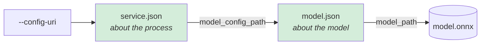

# Quick start · CPU

Five steps to a running server and one scored request, on any CPU: Graviton, Ampere, Intel
or AMD EPYC. The CPU provider is in every ONNX Runtime build, so this is the path that
needs no special hardware and no build flags.

| You need | Why |
|---|---|
| Rust toolchain | the service is built from source |
| `libonnxruntime` | the engine, loaded at run time rather than linked (step 1) |
| Python 3, for `scripts/` | only to generate the throwaway model in step 2 |



Two files, because they change at different times: the listener, the log destination and
the thread counts belong to the host, and the artifact, the provider and the feature
mapping belong to the model.

---

## 1 · Get ONNX Runtime

The engine is loaded at run time, never linked, so this is a download rather than a build
dependency. The [releases page](https://github.com/microsoft/onnxruntime/releases) carries
a prebuilt shared library for every platform, named `onnxruntime-<os>-<arch>-<version>`:

| Platform | Asset for 1.28.0 | Library inside `lib/` |
|---|---|---|
| Linux x64 | `onnxruntime-linux-x64-1.28.0.tgz` | `libonnxruntime.so` |
| Linux arm64 | `onnxruntime-linux-aarch64-1.28.0.tgz` | `libonnxruntime.so` |
| macOS, local development | `onnxruntime-osx-arm64-1.28.0.tgz` | `libonnxruntime.dylib` |

Unpack it and point `ORT_DYLIB_PATH` at the library:

```bash
export ORT_DYLIB_PATH=$PWD/onnxruntime-linux-x64-1.28.0/lib/libonnxruntime.so
```

Already have ONNX Runtime installed system-wide? Leave `ORT_DYLIB_PATH` unset and the
usual library names are tried for you, in a documented order:
[hardware.md](hardware.md#finding-the-runtime) lists them.

## 2 · Make a model

Three features in, two scores out: a sigmoid over a linear layer with fixed weights, so
the answer is predictable and a wrong one is visible.

```bash
pip install -r scripts/requirements.txt
python scripts/generate_test_model.py 3
# wrote hushar/test-data/sigmoid_model_3.onnx
# wrote onnxrt-rs/test-data/sigmoid_model_3.onnx
```

## 3 · Write two config files

```bash
cat > service.json <<'EOF'
{
  "port_number": 50051,
  "model_config_path": "model.json",
  "inference_log": { "uri": "./logs" }
}
EOF

cat > model.json <<'EOF'
{
  "model_id": "quickstart",
  "model_path": "hushar/test-data/sigmoid_model_3.onnx",
  "vectorization_config": { "feature_order": ["f1", "f2", "f3"] }
}
EOF
```

`feature_order` is the whole mapping here: three features, concatenated in that order,
into the model's one 3-wide float input. Every other field has a default, including the
provider, which is `cpu`. [configuration.md](configuration.md) has all of them.

## 4 · Run it

One flag, because `service.json` carries everything else.

```bash
cargo run --release -p hushar -- --config-uri ./service.json
```

The banner is the contract. Read it before sending anything:

```
hushar: model quickstart loaded on onnxruntime/CPU (runtime 1.28.0)
  inputs   : input FP32[3]
  outputs  : output FP32[2]
  features : 1 binding(s)
             input FP32[3] <- [f1, f2, f3] transformed and concatenated
hushar: metrics -> stderr [every 500 batches, 4 in flight]
hushar: inference logs -> ./logs [local filesystem, 16 prefix shard(s), every 5000 batches, 4 in flight, logging every request]
hushar: threads -> 8 async, 8 concurrent inference(s) x 1 intra-op x 8 session(s) = 8 compute on 8 core(s)
  admit  : 500 in flight per connection
hushar: listening on 0.0.0.0:50051
```

Four things to check in it: the backend and runtime version on the first line, the feature
binding (every name you intend to send, in the order the model expects), the thread line
(see [threads-and-cores.md](threads-and-cores.md)), and the address.

## 5 · Send a request

```bash
cargo run -p benchmark-client --example smoke
#   row-0 FP32 = [0.9568927, 0.9568927]
```

The example defaults to `http://127.0.0.1:50051` and `f1=1.0,f2=2.0,f3=3.0`. Override
either, and pick a model by id when more than one is loaded:

```bash
SMOKE_FEATURES='f1=1.0,f2=2.0,f3=3.0' \
  SERVER_ADDR=http://127.0.0.1:50051 \
  SMOKE_MODEL=quickstart \
  cargo run -p benchmark-client --example smoke
```

`name=value` is a number and `name:value` is text, kept apart because `city=1` and `city:1`
mean different things to a one-hot encoding. [api.md](api.md) is the full wire contract.

The server wrote a record of that request under `./logs`. Read it back with:

```bash
cargo run -p benchmark-client --example inspect_log -- ./logs
```

---

## When it does not work

| Symptom | Cause |
|---|---|
| startup fails naming several library file names | no `libonnxruntime` found: set `ORT_DYLIB_PATH` to the file from step 1 |
| `UnsupportedApiVersion` | the library is older than the vendored header; use 1.28.0 or newer |
| startup rejects a configuration field | unknown fields are refused rather than ignored, everywhere except inside a transformation payload; check the spelling against [configuration.md](configuration.md) |
| startup complains about the model input | `feature_order` requires exactly one FP32 or FP64 model input; the banner prints what the model actually has |
| the client cannot connect | `port_number` defaults to `8279` when omitted, and this quick start sets `50051` |
| a `file://` URI fails | it must contain an absolute path |

## Next

| Want to | Read |
|---|---|
| run on a GPU | [quickstart-gpu.md](quickstart-gpu.md) |
| run on Trainium or Inferentia | [quickstart-neuron.md](quickstart-neuron.md) |
| send your own features | [api.md](api.md) and [configuration.md](configuration.md#vectorization_config) |
| get the thread counts right | [threads-and-cores.md](threads-and-cores.md) |
| see what one request does inside | [request-walkthrough.md](request-walkthrough.md) |

Tests follow the same rule as the server: the ones that need real inference skip with a
reason when no library is present.

```bash
cargo test              # unit tests only
export ORT_DYLIB_PATH=… # the library from step 1
cargo test              # everything, on CPU
```
