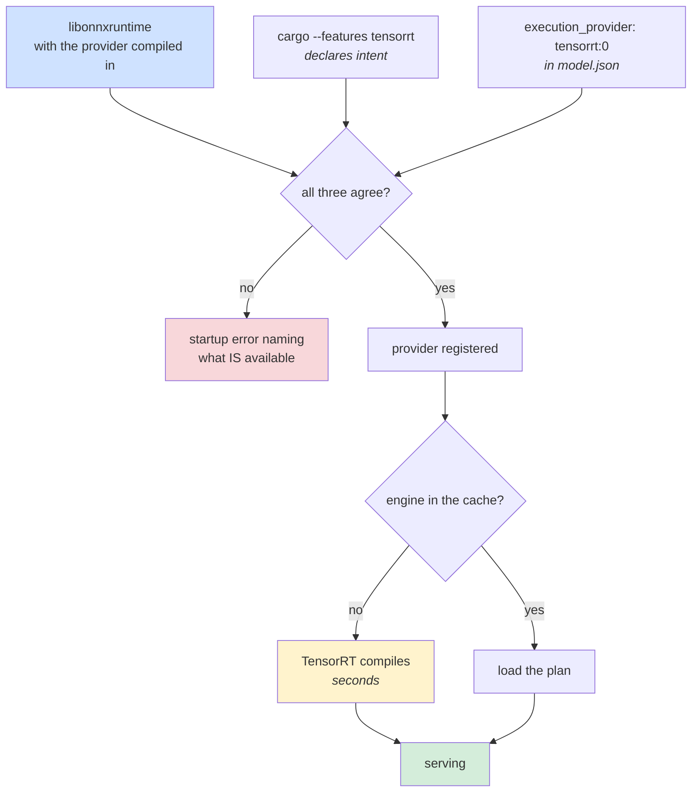

# Quick start · GPU

NVIDIA through TensorRT, AMD through MIGraphX. Same binary, same `model.json`, same
request: a GPU is one line of configuration plus a build that was told to allow it.

Start from [quickstart-cpu.md](quickstart-cpu.md) if you have not run the service before.
This page is only what changes.

| | CPU | GPU |
|---|---|---|
| ONNX Runtime archive | `onnxruntime-linux-x64` | `onnxruntime-linux-x64-gpu_cuda12` or `-gpu_cuda13` (NVIDIA), a ROCm build (AMD) |
| Cargo feature | `cpu`, the default | `tensorrt` or `migraphx` |
| `execution_provider` | `cpu`, the default | `tensorrt:0` or `migraphx:0` |
| First inference | warm | **compiles the graph**, seconds not milliseconds |



The third input is the one that surprises people: a provider is compiled **into**
`libonnxruntime`, and that library is resolved at run time, so no Cargo feature can make
TensorRT exist on a host whose library lacks it. The service asks the library what it has
before registering anything, and says so at startup.

---

## 1 · Get a GPU-enabled ONNX Runtime

The NVIDIA archive carries the CPU provider **and** TensorRT, so one download covers both:

```bash
# NVIDIA, CUDA 12
curl -fsSLO https://github.com/microsoft/onnxruntime/releases/download/v1.28.0/onnxruntime-linux-x64-gpu_cuda12-1.28.0.tgz
tar xf onnxruntime-linux-x64-gpu_cuda12-1.28.0.tgz
export ORT_DYLIB_PATH=$PWD/onnxruntime-linux-x64-gpu_cuda12-1.28.0/lib/libonnxruntime.so
```

AMD is not on the releases page: use AMD's ROCm container or build with `--use_migraphx`.
[hardware.md](hardware.md#getting-a-library) has the build recipe.

## 2 · Build with the provider allowed

```bash
cargo build --release -p hushar --features tensorrt
# or --features migraphx
# or --features all-providers, to decide from the config file
```

The feature declares intent: it lets the build accept that `execution_provider` value and
compiles that provider's tests. Without it, a config naming the GPU fails at startup
rather than quietly running on CPU.

## 3 · Point the model at the device

```json
{
  "model_id": "quickstart-gpu",
  "model_path": "model.onnx",
  "execution_provider": "tensorrt:0",
  "mini_batch_size": 100,
  "is_fixed": true,
  "vectorization_config": { "feature_order": ["f1", "f2", "f3"] }
}
```

`tensorrt:0` is the CUDA device ordinal. `trt` is accepted as a shorter spelling, and
`migraphx:0` is the AMD equivalent. `cuda` and `rocm` are refused **by name**, pointing at
`tensorrt` and `migraphx`, because both have their own registration path in ONNX Runtime
and the generic one would fail confusingly.

A fixed `mini_batch_size` is worth setting here even though it is optional. An engine built
for one shape is the fast case on a GPU: the shape is static on both sides and nothing has
to be rebuilt when a request arrives.

### TensorRT options, after the device id

Each extra `:key=value` becomes a provider option. The practical one is the engine cache.

| Suffix | ONNX Runtime option it sets |
|---|---|
| `cache=/var/cache/trt` | `trt_engine_cache_enable=1`, `trt_engine_cache_path` |
| `timing_cache=/var/cache/trt` | `trt_timing_cache_enable=1`, `trt_timing_cache_path` |
| `fp16=on` | `trt_fp16_enable` (`1/true/on/yes` or `0/false/off/no`) |
| `workspace=2147483648` | `trt_max_workspace_size` |
| `opt_level=3` | `trt_builder_optimization_level` |
| any `trt_*` key | passed through as ONNX Runtime spells it |

```json
"execution_provider": "trt:0:cache=/var/cache/trt:fp16=on"
```

## 4 · Run it, and expect a pause

```bash
ORT_DYLIB_PATH=… cargo run --release -p hushar --features tensorrt -- --config-uri ./service.json
```

TensorRT **compiles** the graph on first use and MIGraphX compiles a program, so the first
inference after startup can take seconds. A latency number taken without warmup on a GPU
is meaningless, which is why the load generator has a `--warmup-secs` flag.

An engine cache moves that compile to the first run ever rather than the first run of
every process. Do not expect it to make startup quick: a cached load still pays the
session and device setup around the compile, which is most of the wait. Plan for a slow
start either way, and warm up before measuring.

Check the banner names the provider you asked for. If it does not, the library lacks it,
and that is the only thing that could be wrong at that point.

## 5 · Send a request

Unchanged from CPU:

```bash
cargo run -p benchmark-client --example smoke
```

---

## How many requests on the device at once

`threading.sessions_per_model` is the knob: each session is an ONNX Runtime session and an
execution context, and it decides how many requests may be on the device at once. Leave it
at the default of 1 and requests queue for a single context, which idles the card between
calls. Two is the smallest number that keeps one request on the device while the next is
being prepared, and a heavier graph wants more.

```json
"threading": { "sessions_per_model": 2 }
```

Each session holds its own copy of the engine in device memory, so this trades accelerator
memory for concurrency. Raise it until the device is busy rather than until the host is.

The ORT CPU knobs (`intra_op_threads`, `inter_op_threads`, `allow_spinning`) still apply
to whatever the provider hands back to CPU. TensorRT does not implement every ONNX
operator, and nodes it cannot take fall back to CPU, which means host-device copies
mid-graph. [threads-and-cores.md](threads-and-cores.md) covers the arithmetic.

## Next

| Want to | Read |
|---|---|
| choose a provider, or build one that is not prebuilt | [hardware.md](hardware.md) |
| size sessions and threads | [threads-and-cores.md](threads-and-cores.md) |
| run a load test on real instances | [benchmarking.md](benchmarking.md) |

```bash
cargo test --features tensorrt   # on an NVIDIA host
cargo test --features migraphx   # on an AMD GPU host
```

Provider tests are compiled by the matching feature and skip with a reason when the loaded
library does not have the provider, so the suite stays green everywhere.
