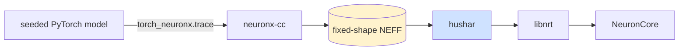
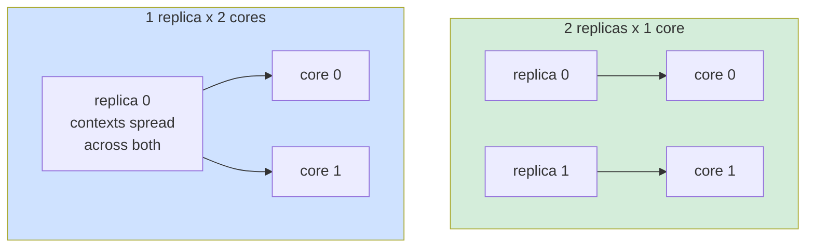

# Quick start · Trainium and Inferentia

AWS Neuron is a **separate backend**, not an ONNX Runtime execution provider. The service
loads a complete NEFF through `libnrt-rs` and places replicas of it on NeuronCores, so
compilation happens before startup and no part of the graph falls back to CPU.

Start from [quickstart-cpu.md](quickstart-cpu.md) if you have not run the service before.
This page is only what changes.

| | ONNX Runtime | Neuron |
|---|---|---|
| Artifact | `.onnx`, read at startup | `.neff`, compiled beforehand |
| Cargo feature | one per provider | none; always compiled |
| Found at run time | `libonnxruntime` | `libnrt.so.1`, plus a matching driver |
| Batch shape | dynamic, unless pinned | **part of the executable**, so always fixed |
| Parallelism knob | sessions, intra-op and inter-op threads | replicas, cores per replica, execution contexts |
| Partial graphs | nodes can fall back to CPU | never; the whole NEFF runs on device |



---

## 1 · A Neuron host

A Neuron 2.31 DLAMI, which carries the driver, `libnrt` and the PyTorch trace environment.
On [`trn1.2xlarge`](https://aws.amazon.com/ec2/instance-types/trn1/) one Trainium chip
provides **two NeuronCores** and 32 GB of accelerator memory, alongside 8 vCPUs and
32 GiB of host memory. That pair of cores is the unit the placement fields below divide up.

## 2 · Compile a NEFF

[Neuron does not compile ONNX files](https://awsdocs-neuron.readthedocs-hosted.com/en/v2.9.1/general/faq/onnx-faq.html),
so the artifact comes from PyTorch through `torch_neuronx.trace` and `neuronx-cc`. The
compiler script in this repository builds a deterministic model of a given size, which
makes it the quickest way to get a working NEFF:

```bash
source /opt/aws_neuronx_venv_pytorch_2_9/bin/activate
python scripts/benchmark/compile_neuron.py --params 10M --batch-size 50
# wrote benchmark-data/generated/bench_model_neuron_10m_b50.neff
# wrote benchmark-data/generated/bench_model_neuron_10m_b50_config.json
# wrote benchmark-data/generated/bench_model_neuron_10m_b50_metadata.json
# maximum compiled-versus-PyTorch error: …
```

Three files: the executable, a ready-to-use `model.json`, and metadata recording the
compiler version, the artifact hash and the largest disagreement between the compiled
model and the PyTorch original. The compiler work directory is kept beside them.

`--batch-size` is the decision that cannot be changed later. It is compiled in.

## 3 · Configure the backend

The config the compiler wrote is already correct; this is what it contains and why.

```json
{
  "model_id": "model-v1-neuron-b50",
  "model_path": "model-b50.neff",
  "backend": {
    "type": "neuron",
    "start_neuron_core": 0,
    "neuron_cores_per_replica": 1,
    "execution_contexts_per_replica": 2
  },
  "mini_batch_size": 50,
  "is_fixed": true,
  "vectorization_config": { "feature_order": ["age", "amount"] }
}
```

The row shape is part of the executable, so `mini_batch_size` must **equal** the NEFF batch
and `is_fixed` must be `true`. Inputs may be FP32, INT32 or INT64 and outputs must be FP32,
of rank one or two with fixed non-zero dimensions. Unsupported ranks, types and byte sizes
fail at startup rather than at the first request.

ONNX Runtime's `execution_provider`, `intra_op_threads`, `inter_op_threads`,
`allow_spinning` and `session_config` do not apply to a Neuron model.

## 4 · Run it

```bash
cargo run --release -p hushar -- --config-uri ./service.json
```

The banner reports the libnrt version, the occupied NeuronCore range, the replica count and
the execution contexts. Treat it as the deployment contract: it is the only place that
states which cores this process took.

## 5 · Send a request

Unchanged, and the point of the design: the caller sends named features either way.

```bash
cargo run -p benchmark-client --example smoke
```

---

## Placement: replicas, cores, contexts

Four numbers decide how a chip is divided, and they are all counts rather than ratios.

| Field | Lives in | Means |
|---|---|---|
| `threading.sessions_per_model` | `service.json` | how many logical replicas to load |
| `start_neuron_core` | `backend` | the first core the first replica uses |
| `neuron_cores_per_replica` | `backend` | consecutive cores each replica spans |
| `replicas_per_neuron_core` | `backend` | replicas stacked on one core range, each a further copy of the weights |
| `execution_contexts_per_replica` | `backend` | mini-batch executions that may be in flight inside one replica |

Two ways to use the two cores of a `trn1.2xlarge`, and they are different tradeoffs rather
than better and worse:



- **Two one-core replicas** serve two requests at once, one per core.
- **One two-core replica** loads a full copy of the NEFF on each core and spreads its
  execution contexts across them, so two mini-batches of a *single* request run in
  parallel. This is data parallelism, not model sharding.

`execution_contexts_per_replica` must be at least the core count, and a useful value is
`ceil(request rows / mini_batch_size)`, because a replica serves one request at a time.
With 100-row requests and a batch-50 NEFF, that is 2.

The service checks each requested core range against the NeuronCores visible to libnrt, but
it does **not** detect overlap between a control model's range and a candidate's. Choose
`start_neuron_core` deliberately when loading two models.

## Testing

```bash
cargo test -p hushar neuron
```

The signature and configuration tests run everywhere, including a laptop. Loading and
execution need a Neuron host, `libnrt.so.1`, a matching driver and a compiled NEFF:

```bash
PROVIDER=neuron \
  MODEL_CONFIG=benchmark-data/generated/bench_model_neuron_10m_b50_config.json \
  NEFF_PATH=benchmark-data/generated/bench_model_neuron_10m_b50.neff \
  MINI_BATCH_SIZE=50 SESSIONS=2 scripts/benchmark/run_server.sh start
```

## Next

| Want to | Read |
|---|---|
| tune replicas and contexts | [threads-and-cores.md](threads-and-cores.md#aws-neuron-sdk) |
| see every backend field | [configuration.md](configuration.md#aws-neuron-backend) |
| read how the NEFF path is wired | [hardware.md](hardware.md#aws-neuron) and [bindgen.md](bindgen.md) |
| run a benchmark on a Neuron host | [benchmarking.md](benchmarking.md#compile-a-neuron-model) |

One limitation to design around: a NEFF is loaded with one fixed batch, so serving several
request shapes means compiling and selecting one artifact per shape. That is listed in the
README's future scope.
