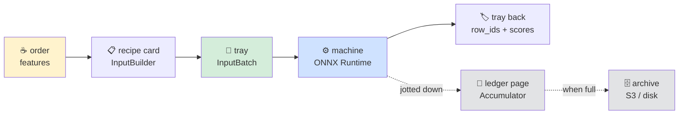
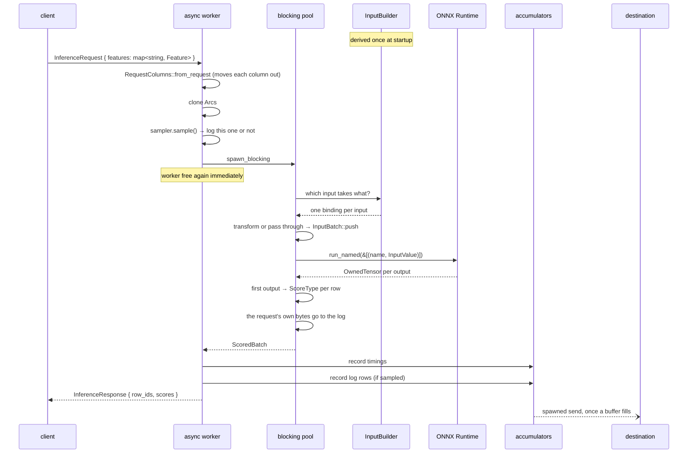
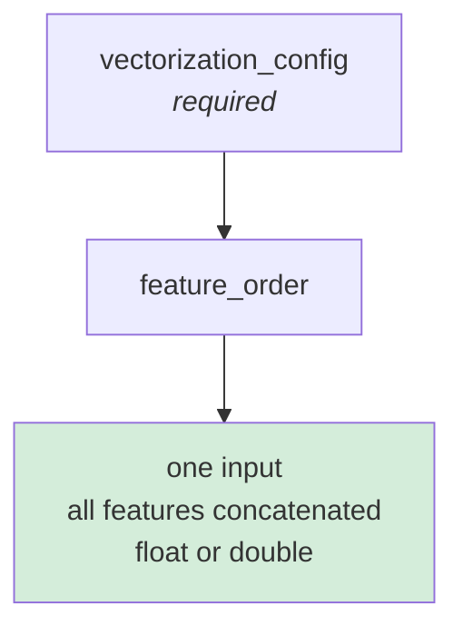
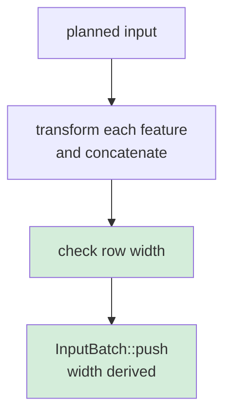
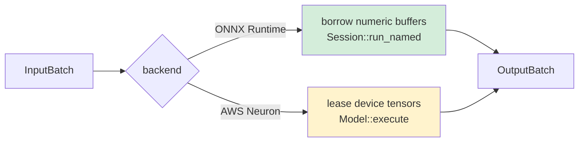
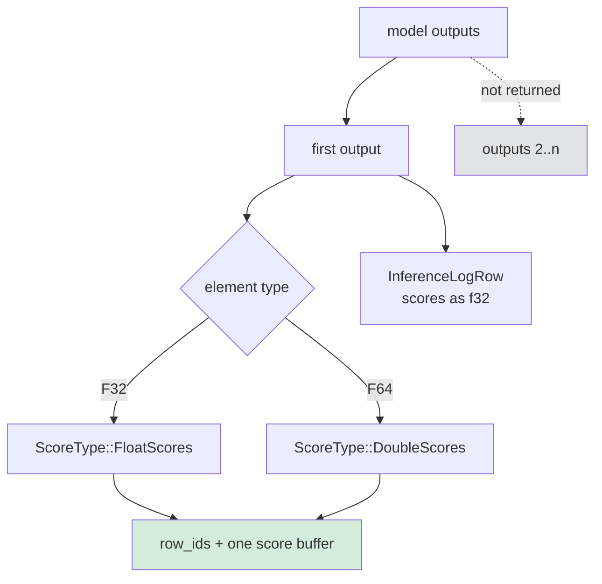
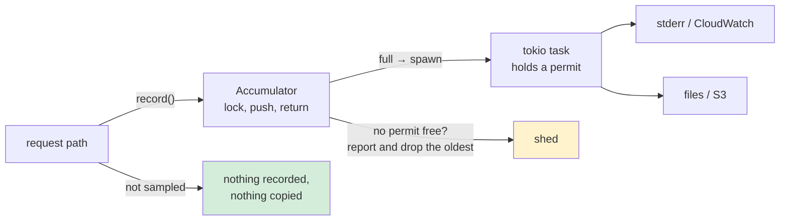

# One inference request, end to end

Follows a single request from the socket to the response, naming the function at each step.
[api.md](api.md) is the contract the request arrives on and [configuration.md](configuration.md)
covers the fields this reads; here it is what actually happens, in order.

The worked example throughout is the real thing, taken from a running server:

```bash
SMOKE_FEATURES='f1=1.0,f2=2.0,f3=3.0' cargo run -p benchmark-client --example smoke
#   row-0 FP32 = [0.9568927, 0.9568927]
```

---

## ELI5

A request is a **coffee order**.

1. The counter takes your order — a few named things, in your words.
2. The counter does not make the coffee. It hands the order to the kitchen, because if the
   counter stopped to make one, nobody else could order.
3. The kitchen has a **recipe card** written when it opened, saying which order fields go
   into which machine slot.
4. Ingredients get measured out onto a tray, counted once.
5. The machine runs.
6. What comes out is poured into a cup with your name on it.
7. A copy of your order goes in a ledger — jotted on a running page, walked to the archive
   only when the page is full, so nobody waits for the archive.



The recipe card matters most. It is written **once at startup**, not per order, so a
mistake in it stops the shop opening rather than ruining every drink.

---

## The whole journey



The two dotted arrows are the point: everything observability-related leaves the request
path before the response is built, and never blocks it.

---

## Step 1 · The socket

[`HusharService::inference_service`](../hushar/src/main.rs)

```rust
let inference_req = request.into_inner();
let request_id = inference_req.request_id;
let rows = inference_req.inputs;
```

One request shape, so there is nothing to disambiguate. The features are a
`map<string, Feature>`, one entry per feature holding the whole batch, turned into the
service's own columns here — and because prost has already decoded each array into a `Vec`,
that step *moves* the buffers rather than copying them. A caller that has already vectorized
sends its vector as one entry of that width.

**ELI5:** the counter reads the order. There is only one kind of order form, so there is no
"which form is this?" step.

---

## Step 2 · Off the async worker

```rust
let scored = tokio::task::spawn_blocking(move || {
    let session = model.sessions.acquire();
    let scored = inference::scoring::score_features(
        session.as_ref(),
        &columns,
        &input_builder,
        mini_batch,
        logging,
    );
    (scored, columns)
})
.await
.map_err(|e| Status::internal(format!("inference task failed to complete: {e}")))?;
```

Inference is CPU-bound and can run for milliseconds, so it leaves the async runtime. The
blocking pool is capped at `threading.sessions_per_model` in
[`main`](../hushar/src/main.rs) rather than tokio's default 512. On that thread the request
leases one of the model's sessions from a
[`SessionPool`](../hushar/src/inference/session_pool.rs) for exactly as long as it scores
and returns it when the lease drops, so no two requests ever share one session's intra-op
pool — however tokio's blocking threads come and go. Because the pool is as wide as there
are sessions, the lease never waits.

**ELI5:** the counter hands the order to the kitchen and goes back to taking orders.

---

## Step 3 · The recipe card, checked at startup

[`InputBuilder::resolve`](../hushar/src/inference/input_builder.rs) — called **once**, in
`main`, not per request. It takes the **declared** `vectorization_config` and the model's
own signature, and refuses any disagreement between them.



One rule, and it holds for every feature:

> Features are transformed and concatenated in `feature_order`, so the model always
> receives a numeric vector per row — and a feature the request leaves out contributes
> its transformation's `default_val`.

`resolve` settles the input's element type and its **width**, taking it from the model
where the model fixes it and from the configuration where the model leaves the axis
dynamic. The input then has a definite width before any request arrives, and the result
is printed so a deployment mistake is visible at boot:

```
hushar: model fraud-v3 loaded on onnxruntime/CPU (runtime 1.28.0)
  inputs   : features FP32[7]
  outputs  : score FP32[1]
  features : 1 binding(s)
             features FP32[7] <- [age, city, tags] transformed and concatenated
```

→ [configuration.md](configuration.md) for the fields. The mapping is declared rather than
inferred from the signature because an ONNX file does not record the schema of the data the
model was trained on — so it has to be stated, and can then be checked against the model.

**ELI5:** the recipe card is checked against the machines when the shop opens. If it does
not match, the shop does not open.

---

## Step 4 · Building the inputs

[`score_features`](../hushar/src/inference/scoring.rs) →
[`InputBuilder::build_padded`](../hushar/src/inference/input_builder.rs), once per chunk.



The features reach the log **as received, before any transformation** — and no feature data
is copied to get them there. The builder only ever *borrows* the decoded columns, copying a
contiguous run out of each into the engine's buffer, so the columns are still intact
afterwards; `into_wire` then moves each one straight back into the message it arrived in.
The engine gets one memcpy per input, and the log gets the caller's own values: `city` as
`"london"`, not as the one-hot vector the model saw.

A feature the request leaves out falls back to its transformation's `default_val`, so a
partial request still scores. A column is present for the whole request or absent from it,
so there is no per-row hole to report.

A transformation refuses a column type it cannot take rather than converting it: a
`Float64` column fed to a `standardization32` feature is refused, not narrowed. The error
names the row, so a bad request is traceable.

The `FP64` route is not the `FP32` route widened — `Identity` and the 64-bit scalers
implement [`transform_f64`](../hushar/src/inference/transformations.rs) directly.

### Our example

```
f1=1.0, f2=2.0, f3=3.0   →  transformed in feature_order  →  [1.0, 2.0, 3.0]
                         →  InputBatch::push("input", F32)  →  width 3
```

`rows` was fixed when the batch was created, so
[`push`](../hushar/src/inference/batch.rs) **derives** the width as `values / rows` — there
is no second number that could disagree with the buffer. It refuses a value count that is
not a whole number of rows, an empty column for a non-empty batch, and a repeated input
name.

**ELI5:** ingredients measured onto a labelled tray, counted once. Anything after this
trusts the tray.

---

## Step 5 · Into the engine

[`InferenceBackend::run`](../hushar/src/inference/backend.rs) has two implementations:
[`OnnxRuntimeBackend`](../hushar/src/inference/onnx_backend.rs) and
[`NeuronBackend`](../hushar/src/inference/neuron_backend.rs).



The trait takes `InputBatch` **by value**. ONNX Runtime uses that ownership to lend numeric
buffers directly to `CreateTensorWithDataAsOrtValue`; only strings copy. Neuron instead
leases a preallocated input/output tensor set, copies fixed-size numeric buffers to device
memory, executes the NEFF, and reads FP32 scores back. Several Neuron execution contexts
allow one loaded replica to run split mini-batches without sharing mutable tensors.

Both implementations derive names, types, ranks and widths from the model itself and
validate them before traffic. ORT accepts dynamic row axes. A NEFF is fixed and therefore
requires matching `mini_batch_size` plus `is_fixed: true`.

Coming back, each engine verifies every declared output has one row per input row and
builds the same `ScoreData`/`OutputBatch`, so the request path after this point does not
know which engine ran.

**ELI5:** the same labelled tray reaches either kitchen; each kitchen uses its own
cookware and returns the same labelled cup.

---

## Step 6 · Scores out

[`run_batch`](../hushar/src/inference/scoring.rs) →
[`to_score_type`](../hushar/src/inference/scoring.rs)



Only the first output is returned, and `FP64` is not narrowed on the way out — the log
narrows to `f32` because it is read by batch jobs that want one stable column. Row count is
checked against the request before anything is read, so outputs can never be correlated to
the wrong rows.

### Our example

```
model output "output" FP32 [1, 2] = [0.9568927, 0.9568927]
  → row_ids: ["row-0"], scores: FloatScores([0.9568927, 0.9568927])
```

**ELI5:** poured into a cup with your name on it.

---

## Step 7 · The ledger, on the same thread

Back in [`inference_service`](../hushar/src/main.rs):

```rust
self.metrics_sink.record(&batch.timings);

if logging == FeatureLogging::Record {
    // The request's own columns, moved back into the wire's shape.
    let (row_ids, features) = columns.into_wire();
    self.data_sink.record(InferenceLogBatch {
        request_id,
        model_id: self.model_id.clone(),
        row_ids,
        features,
        scores: Some(FloatArray { values: batch.log_scores }),
    });
}
```

Both calls are **synchronous and non-blocking**. Each takes a lock, appends, and returns;
the request that fills a buffer additionally hands the whole batch to a spawned task. No
request ever waits on S3, CloudWatch or the disk, and no thread is reserved away from
serving to make that true.



See [`accumulator.rs`](../hushar/src/io/accumulator.rs) for what each request pays and how
memory stays bounded without a channel. The three levers are documented in
[configuration.md](configuration.md#what-the-observability-levers-cost).

**ELI5:** the counter jots your order on a running page and hands you your coffee. When the
page is full someone walks it to the archive. If every runner is still out, the oldest page
is thrown away and the shop writes down that it happened — you still get your coffee.

---

## What the timings actually measure

[`InferenceMicros`](../hushar/src/inference.rs) carries three numbers, emitted under the
names in [`metrics.rs`](../hushar/src/io/metrics.rs):

| Field | Metric name | What it really spans |
|---|---|---|
| `vec_time` | `VectorizationTime` | padding a short batch and building every input tensor |
| `tensor_time` | `ToTensorTime` | `build_start` → `inference_start`: a function call |
| `inference_time` | `InferenceTime` | `backend.run`, the engine itself |

**`ToTensorTime` no longer measures anything meaningful.** The two stages were separate
when tensor construction followed vectorization as its own step; they now happen together
inside `InputBuilder::build_padded`, so `vec_time` covers both. Worth knowing before reading a
dashboard.

---

## The journey in one table

| # | Where | Function | Turns |
|---|---|---|---|
| 1 | `main.rs` | `inference_service` | gRPC → `RequestColumns` (one entry per feature) |
| 2 | `main.rs` | `spawn_blocking` | async worker → blocking pool |
| 3 | *startup* | `InputBuilder::resolve` | declared config + model signature → planned inputs |
| 4 | `input_builder.rs` | `build_padded` | columns + a row range → one `Feature` per model input |
| 5 | `onnx_backend.rs` | `run` → `run_named` | `InputBatch` → `OrtValue` → `OutputBatch` |
| 6 | `scoring.rs` | `to_score_type` | first output → one `ScoreType` for the batch |
| 7 | `main.rs` | `record` ×2 | timings, and the payload + scores → accumulators |

Where each failure is caught, and whether it stops the server or one request, is tabulated
in [configuration.md](configuration.md#what-is-checked-and-when).

---

## Try it

```bash
export ORT_DYLIB_PATH=…   # the ONNX Runtime library for your platform

hushar --config-uri ./service.json
# read the banner: inputs, outputs, and the feature bindings

SMOKE_FEATURES='f1=1.0,f2=2.0,f3=3.0' \
  SERVER_ADDR=http://127.0.0.1:50051 cargo run -p benchmark-client --example smoke
```

The banner and the response together are the whole contract: what the model wants, where
each input comes from, and what came back.
