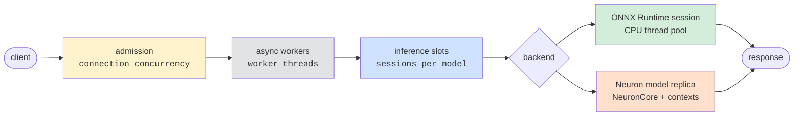
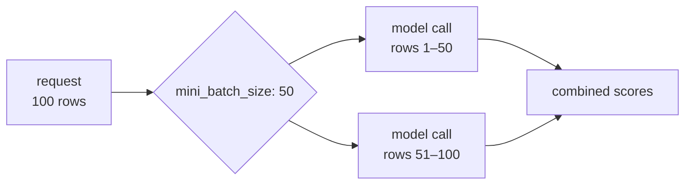
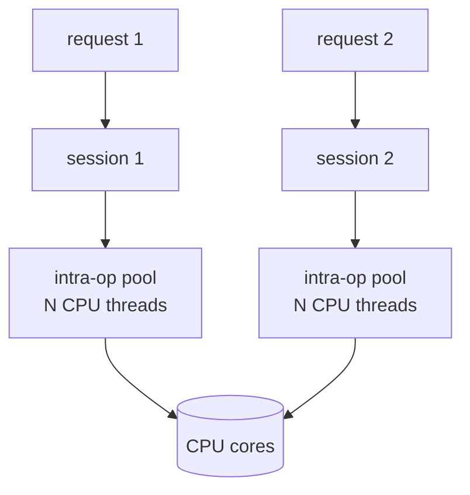
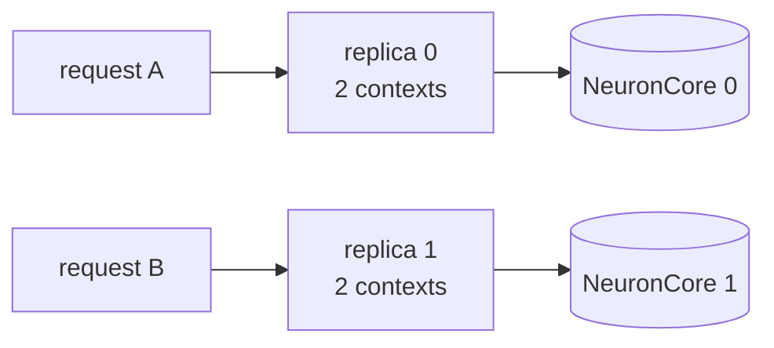

# Threads, sessions, and accelerator cores

Hushar uses two kinds of parallelism:

1. **Service parallelism** moves requests through the process. It is shared by every
   backend.
2. **Backend parallelism** runs model inference. ONNX Runtime uses CPU thread pools;
   AWS Neuron uses model replicas, NeuronCores, and execution contexts.

Choose the backend first, then tune its parallelism. CPU thread counts do not describe
how a Trainium device runs a model.



> **Simple mental model:** The front door admits customers, waiters move their orders,
> and kitchens prepare them. `sessions_per_model` is the number of kitchens. An ONNX
> Runtime kitchen has CPU workers; a Neuron kitchen is a model replica assigned to
> NeuronCores.

## Settings at a glance

| Setting | Configuration | Applies to | What it controls |
|---|---|---|---|
| `connection_concurrency` | `service.json` → `threading` | all backends | requests admitted per client connection |
| `worker_threads` | `service.json` → `threading` | all backends | async networking and service work |
| `sessions_per_model` | `service.json` → `threading` | all backends | independent backend units and concurrent request slots |
| `intra_op_threads` | `service.json` → `threading` | ONNX Runtime | CPU threads used inside one operator |
| `inter_op_threads` | `service.json` → `threading` | ONNX Runtime | CPU threads used across independent operators |
| `allow_spinning` | `service.json` → `threading` | ONNX Runtime | whether idle runtime threads poll or sleep |
| `session_config` | `service.json` → `threading` | ONNX Runtime | additional ONNX Runtime session settings |
| `mini_batch_size` / `is_fixed` | `model.json` | all backends | how request rows are divided before inference |
| `start_neuron_core` | `model.json` → Neuron `backend` | AWS Neuron | first NeuronCore used for model placement |
| `neuron_cores_per_replica` | `model.json` → Neuron `backend` | AWS Neuron | consecutive cores used by one logical replica; each holds a complete NEFF copy |
| `execution_contexts_per_replica` | `model.json` → Neuron `backend` | AWS Neuron | overlapping model calls available within one replica |

The complete field reference is in
[configuration.md](configuration.md#threading). The startup banner prints the effective
values and should be checked before sending traffic.

## Shared service parallelism

These settings have the same role for ONNX Runtime and AWS Neuron.

### Admission: `connection_concurrency`

`connection_concurrency` limits in-flight requests **per connection**. It protects the
front door; it does not create inference capacity.

One tonic `Channel` uses one HTTP/2 connection even when cloned. A benchmark that drives
only one connection can therefore measure the connection limit instead of the server.
Use several connections when testing a large host.

### Async work: `worker_threads`

`worker_threads` runs sockets, HTTP/2, metrics, and other async tasks. These workers do not
run inference. More workers do not make the model compute faster, and too many take CPU
from host-side inference and data preparation.

Start with the default, then change it only when service-level measurements show that
async work is the bottleneck.

### Request slots: `sessions_per_model`

`sessions_per_model` is the main request-concurrency setting. A request leases one
backend unit while it scores; additional requests wait for an available unit.

The unit depends on the backend:

| Backend | One unit means | Main resource cost |
|---|---|---|
| ONNX Runtime | one independent session with its own CPU thread pool | another copy of model weights and another thread pool |
| AWS Neuron | one loaded model replica on a consecutive NeuronCore range | another device model load and its tensor contexts |

The default is `1`, which means one request can run at a time for each model. Raise it for
throughput only after deciding how much parallelism each backend unit needs.

### Rows and mini-batches

Rows per request are part of the parallelism decision. `mini_batch_size` divides a request
into smaller model calls, while `is_fixed` pads a short final batch for a fixed-shape
model.



Splitting can expose more parallel work, but every piece repeats call and transfer
overhead. Benchmark the request sizes used in production rather than assuming that
smaller batches are faster.

## ONNX Runtime on CPU

Each ONNX Runtime session owns a CPU thread pool. Several sessions let requests run in
parallel; wider pools let one request use more CPU cores.



For one model, use this as a planning estimate:

```text
CPU compute threads ≈ sessions_per_model × pool width

pool width = intra_op_threads or inter_op_threads
```

Aim near the physical CPU cores available for inference, then leave headroom for async
workers, logging, the operating system, and load variation. This is a starting point, not
a substitute for measurement.

For example, this configuration creates four independent sessions with a 14-thread
intra-op pool in each session, for an estimated 56 inference threads:

```json
"threading": {
  "worker_threads": 8,
  "sessions_per_model": 4,
  "intra_op_threads": 14,
  "allow_spinning": true,
  "session_config": {
    "session.force_spinning_stop": "1"
  }
}
```

### Intra-op and inter-op are alternatives

| Pool | Parallelizes | Best fit |
|---|---|---|
| `intra_op_threads` | work inside one operator | sequential graphs with large matrix and tensor operators |
| `inter_op_threads` | independent graph operators | graphs with branches that can execute at the same time |

Most transformer graphs are long dependency chains, so intra-op parallelism is usually
the useful choice. Attention heads are dimensions inside operators, not independent graph
branches.

Do not widen both pools. Hushar rejects a configuration where both values exceed `1`.
Also remember that `0` asks ONNX Runtime to choose its default pool width; it does not
disable the pool.

### Spinning

An idle ONNX Runtime thread can either poll for work or sleep:

- `allow_spinning: true` avoids repeated wake-up latency but consumes CPU while waiting.
- `allow_spinning: false` yields the CPU and is safer when pools are oversubscribed or the
  host runs other CPU-heavy work.

With several sessions, bound spinning so idle sessions do not take CPU from active ones:

```json
"session_config": {
  "session.force_spinning_stop": "1",
  "session.intra_op.spin_duration_us": "200"
}
```

`session.force_spinning_stop` stops pool threads when a session's `Run()` completes.
`session.intra_op.spin_duration_us` allows a short polling window before sleeping. Treat
`200` as an example to measure, not a universal default.

### How to tune ONNX Runtime

1. Start with one session and measure several `intra_op_threads` values under light load.
   Stop increasing the width when latency no longer improves.
2. Add sessions to meet the required request rate. Reduce the per-session width so the
   total CPU budget stays reasonable.
3. If `mini_batch_size` fans one request into parallel model calls, start with
   `intra_op_threads: 1` to avoid competing layers of CPU parallelism.
4. Test spinning on and off. When it is on with several sessions, use a bounded spin
   policy.
5. Run sustained load at the real row count and target request rate. A configuration that
   wins an unloaded latency test may lose once requests queue.

A useful direction-of-travel guide is:

| Goal | Sessions | Pool width | Trade-off |
|---|---:|---:|---|
| lower single-request latency | fewer | wider | less request-level concurrency |
| higher request throughput | more | narrower | more model copies and scheduling |
| mini-batch fan-out | based on concurrent requests | `1` initially | more model calls per request |

The figures in this document come from CPU, GPU and Trainium sweeps on the hardware named
with each one, and their raw evidence is no longer in the repository. Read them as tuning
examples rather than as defaults or as a published result: the guidance here is about which
knob does what, not about any one number.

## AWS Neuron SDK

AWS Neuron does not use ONNX Runtime's CPU pools. Hushar loads a compiled NEFF through
`libnrt-rs`, places replicas on NeuronCores, and reuses preallocated execution contexts.
Host CPU workers still prepare requests and move data, but the model runs on Trainium.

The three Neuron parallelism controls are:

```text
request slots              = sessions_per_model
used NeuronCores           = sessions_per_model × neuron_cores_per_replica
calls overlapping/replica  ≤ execution_contexts_per_replica
```

`sessions_per_model` remains in `service.json` because it controls service-level request
slots. Core placement and execution contexts remain in `model.json` because they describe
the compiled model and accelerator.

### Configuration

`service.json` chooses two replicas:

```json
"threading": {
  "worker_threads": 2,
  "sessions_per_model": 2
}
```

`model.json` places each replica on one NeuronCore and gives it two reusable execution
contexts:

```json
{
  "model_id": "fraud-v3-neuron-b50",
  "model_path": "s3://my-bucket/models/fraud/v3/model-b50.neff",
  "backend": {
    "type": "neuron",
    "start_neuron_core": 0,
    "neuron_cores_per_replica": 1,
    "execution_contexts_per_replica": 2
  },
  "mini_batch_size": 50,
  "is_fixed": true,
  "vectorization_config": {
    "feature_order": ["age", "city", "amount"]
  }
}
```

The ONNX Runtime settings `intra_op_threads`, `inter_op_threads`, `allow_spinning`, and
`session_config` are intentionally absent. They are not applied to the Neuron backend.

### Replicas and NeuronCores

Replicas use consecutive core ranges beginning at `start_neuron_core`. With the example
above, two one-core replicas occupy NeuronCores 0 and 1:



If a NEFF requires two NeuronCores, set `neuron_cores_per_replica: 2`; two replicas then
require four visible cores. Hushar checks the requested range at startup.

A replica is another loaded copy of the compiled model. Add replicas when requests queue
and unused NeuronCores are available. A larger replica count cannot exceed the device's
core capacity and consumes additional device memory.

When every core already holds a replica, `replicas_per_neuron_core` lets consecutive
replicas share a core: with `sessions_per_model: 4` and `replicas_per_neuron_core: 2`,
replicas land on cores 0, 0, 1 and 1. A core then serves two requests at once. It still
executes one NEFF at a time, so this does not add compute; it lets one request's host-side
work (vectorization, tensor copies) overlap another request's execution, at the cost of a
second copy of the weights on that core. Measure it against one replica per core before
adopting it.

### Execution contexts

An execution context is a reusable set of input and output tensors. It allows model calls
from one split request to overlap without allocating device tensors on every call.

Contexts do **not** create NeuronCores and do **not** admit more requests: a replica is
leased to one request at a time, so only that request's calls can use its contexts. The
useful value is therefore the number of calls one request produces:

```text
calls per request               = ceil(request rows / mini_batch_size)
execution_contexts_per_replica  = calls per request

fewer contexts  → the request's calls run one after another
more contexts   → the extra contexts are allocated and never leased
```

If one request maps to one NEFF call, keep one context. The startup banner prints this
rule with the configured numbers, since the request size is not known until traffic
arrives.

### Fixed NEFF batches

A NEFF has a fixed input shape. Its leading batch dimension must match
`mini_batch_size`, and `is_fixed` must be `true`. Hushar splits larger requests, pads the
short final batch, and discards scores for padded rows.

For example, a batch-50 NEFF handles a 100-row request as two calls. With two execution
contexts, those calls may overlap on the leased replica.

### How to tune AWS Neuron

1. Compile a NEFF for the batch shape you intend to serve.
2. Start with one replica and one execution context.
3. Add replicas while unused NeuronCores remain and the target request rate needs more
   independent request slots.
4. Set execution contexts to the NEFF calls one request produces
   (`ceil(rows / mini_batch_size)`); a request making one call needs one context.
5. Run sustained load at the real request shape. Check achieved throughput as well as
   latency; latency from an overloaded cell is not a valid winner.

A measured example makes the roles concrete. On a `trn1.2xlarge`, the 50M model at 100
rows and 200 requests per second performed best with two one-core replicas and two
contexts per replica. Each request became two concurrent batch-50 calls. A follow-up on the
same load measured the context rule directly: one context per replica added about 0.13 ms of
inference time, and four contexts were indistinguishable from two. That result is specific
to the compiled model and load; use it as a tuning example, not a default.

## Recognizing common bottlenecks

| Symptom | Likely explanation | Next check |
|---|---|---|
| latency rises only as load increases | requests are waiting for a session or replica | compare offered and achieved rate; test another backend unit if resources remain |
| ONNX Runtime CPU is low with one session | one request cannot expose enough CPU work | sweep intra-op width or test mini-batch fan-out |
| ONNX Runtime latency worsens as pools grow | CPU threads are oversubscribed or spinning too long | reduce total pool width and bound or disable spinning |
| Neuron startup rejects placement | replica core ranges exceed visible NeuronCores | check replica count, cores per replica, and starting core |
| extra Neuron contexts do not help | requests make one NEFF call or the replica is already saturated | return to one context and measure another replica or batch shape |
| a large host plateaus from one client | the client has reached a per-connection limit | drive load through several HTTP/2 connections |

## Before benchmarking

- Confirm the startup banner names the expected backend and effective parallelism.
- Confirm the model batch shape matches the request and mini-batch plan.
- Use multiple client connections when the server can handle high concurrency.
- Hold the target rate long enough to observe a stable window.
- Compare only cells that sustain the offered rate without failures or shedding.
- Record the hardware, model artifact, batch shape, and complete configuration with the
  result.

## Next

- [configuration.md](configuration.md#threading) — field definitions and validation
- [benchmarking.md](benchmarking.md) — running and interpreting benchmarks
- [hardware.md](hardware.md) — choosing backend hardware
- [benchmarking.md](benchmarking.md#6--record) — where a measured run is recorded
