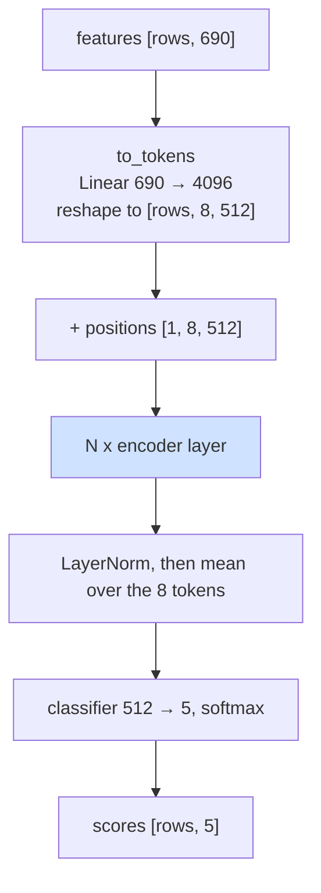
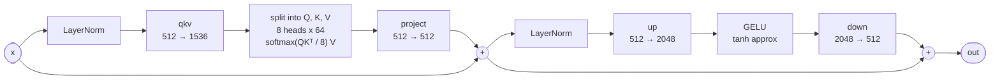
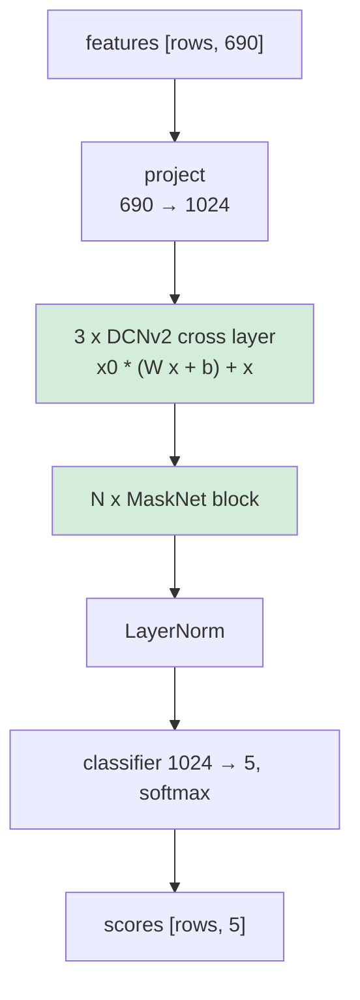

# Benchmark models

Two architectures at a chosen parameter count, both fed the same tensor, so a result from
one is readable against the other. Defined in
[`generate_benchmark_models.py`](generate_benchmark_models.py).

```bash
python scripts/generate_benchmark_models.py --params 10M --out-dir benchmark-data/generated/10m
python scripts/generate_benchmark_models.py --params 20M --out-dir benchmark-data/generated/20m
```

| | written as | 10M | 20M |
|---|---|--:|--:|
| transformer | `bench_model.onnx` | 9,142,789 params, 34.9 MB | 18,599,941 params, 71.0 MB |
| ranking | `bench_dcn_model.onnx` | 9,112,581 params, 34.8 MB | 19,610,629 params, 74.8 MB |

`bench_model` is the one the CPU and accelerator campaigns have used so far.

## The shared input

The service transforms every feature and concatenates the results into a single tensor, so
both models have the same signature:

```text
features [rows, 690]  ──▶  model  ──▶  scores [rows, 5]
```

The 690 is a sum of widths, not a feature count:

| transformation | features | values |
|---|--:|--:|
| `embedding_lookup` | 4 | 240 |
| `one_hot_encoding` | 4 | 240 |
| `min_max_scaling32` | 97 | 97 |
| `standardization32` | 97 | 97 |
| `identity` | 2 | 10 |
| `min_max_scaling64` | 3 | 3 |
| `standardization64` | 3 | 3 |
| **total** | **210** | **690** |

The feature count is padded out deliberately: the service runs one transformation per
feature per request, and that cost is invisible at a dozen features. `VectorizationTime` is
reported separately from `InferenceTime`, so the two stay distinguishable.

---

# `bench_model`: the transformer

A pre-norm encoder stack. This is the model the performance work uses, so it is worth
knowing where its parameters and its arithmetic actually sit.



**There is no sequence here.** `to_tokens` manufactures 8 tokens from one flat feature
vector, which is what lets a tabular model exercise a transformer's shape. The 8 positions
carry no order that means anything, and the pooling is a mean rather than a class token.

## One encoder layer



Attention is written out of `split`, `matmul` and `softmax` rather than taken from
`nn.MultiheadAttention`, because the exported operator list is what an execution provider
has to accept. GELU is the tanh approximation for the same reason: `Erf` is not accelerated
everywhere.

### Where the parameters are

`d_model` 512, `n_heads` 8, `d_ff` 2048, `n_tokens` 8.

| component | shape | parameters |
|---|---|--:|
| `norm_attention` | LayerNorm 512 | 1,024 |
| `qkv` | 512 → 1536 | 787,968 |
| `project` | 512 → 512 | 262,656 |
| `norm_feed_forward` | LayerNorm 512 | 1,024 |
| `up` | 512 → 2048 | 1,050,624 |
| `down` | 2048 → 512 | 1,049,088 |
| **one layer** | | **3,152,384** |

Split by half: attention is 1,051,648 (33.4%) and the feed-forward network is 2,100,736
(66.6%). The dense network holds twice what attention does, which is what `d_ff = 4 ×
d_model` buys.

**The heads hold no parameters of their own.** `qkv` and `project` are `d_model` wide
whatever `n_heads` is; the 8 heads are a reshape of that one projection into 8 x 64. So
changing the head count moves neither the parameter count nor the arithmetic:

| `n_heads` | `head_dim` | layer parameters | attention matmuls |
|--:|--:|--:|--:|
| 1 | 512 | 3,152,384 | 65,536 |
| 4 | 128 | 3,152,384 | 65,536 |
| 8 | 64 | 3,152,384 | 65,536 |
| 16 | 32 | 3,152,384 | 65,536 |

It changes only the shape and count of the batched matmuls — 8 small ones instead of 1
large one — so it is a knob for cache and kernel behaviour, not for model size. Worth
knowing before attributing a latency change to it.

### Where the arithmetic is

Multiply-accumulates for one layer, per row:

| component | MAC/row | share |
|---|--:|--:|
| `up` | 8,388,608 | 33.25% |
| `down` | 8,388,608 | 33.25% |
| `qkv` | 6,291,456 | 24.94% |
| `project` | 2,097,152 | 8.31% |
| attention matmuls | 65,536 | 0.26% |
| **one layer** | **25,231,360** | |

**99.74% of a layer is dense GEMM.** At 8 tokens the attention mechanism itself — the two
batched matmuls and the softmax — is a rounding error. For performance purposes this model
is a stack of four matmuls per layer with a little elementwise work between them, and a
host that is good at GEMM will be good at this.

That also bounds what the token axis costs. Every one of those four matmuls runs over all 8
tokens, so the whole layer is 8x the work its parameter count suggests. The entry and exit
layers run once per row:

| component | parameters | MAC/row |
|---|--:|--:|
| `to_tokens` | 2,830,336 | 2,826,240 |
| `positions` | 4,096 | — |
| final `LayerNorm` | 1,024 | — |
| `classifier` | 2,565 | 2,560 |

## 10M and 20M

Width, head count and `d_ff` are fixed; **depth is solved** to land nearest the target.

| | layers | layer parameters | entry + exit | total | MAC/row |
|---|--:|--:|--:|--:|--:|
| 10M | 2 | 6,304,768 (69%) | 2,838,021 (31%) | 9,142,789 | 53,291,520 |
| 20M | 5 | 15,761,920 (85%) | 2,838,021 (15%) | 18,599,941 | 128,985,600 |

`to_tokens` is a fixed 2.83M that the stack grows past. It is nearly a third of the 10M
model, so the two sizes are not a clean 2x of anything: parameters go up 2.03x and
arithmetic 2.42x.

---

# `bench_dcn_model`: the ranking trunk

The shape a ranking model usually has. One flat vector throughout, no token axis.



**Cross layers** give a bounded interaction degree: after `l` of them the output carries
terms of degree `l + 1` in the input features. Three is what the paper and the deployments
after it use — the cross network is there for interactions, not for depth. `W` is full rank
rather than the paper's low-rank `U Vᵀ`, which exists to save parameters against a far
wider embedding and here would only turn one matmul into two.

**MaskNet blocks** compute a mask from the block's own input through a layer twice as wide,
then multiply it in elementwise before projecting. That product is the point: it gives the
network a multiplicative path, which no stack of additive layers can express.

| | cross layers | blocks | total parameters | MAC/row |
|---|--:|--:|--:|--:|
| 10M | 3 | 1 | 9,112,581 | 9,100,288 |
| 20M | 3 | 3 | 19,610,629 | 19,586,048 |

`project` is 707,584 parameters, the 3 cross layers 3,148,800, and each MaskNet block
5,249,024. Only the block count is solved.

---

# Side by side

The encoder applies its weights to each of 8 tokens; the ranking trunk applies them once.
At a matched parameter count that is several times the arithmetic per row:

| target | `bench_model` | `bench_dcn_model` | ratio |
|---|--:|--:|--:|
| 10M | 53,291,520 MAC/row | 9,100,288 MAC/row | 5.9x |
| 20M | 128,985,600 MAC/row | 19,586,048 MAC/row | 6.6x |

The ceiling is 8x, one per token. It is diluted because `to_tokens` runs once per row
either way, so the ratio climbs as the stack grows. Which of the two a given host prefers
is not readable off a spec sheet, which is why both exist.

# Notes

- Opset 17. The row axis is dynamic, because the service batches whatever a request carries.
  `--with-batch1` additionally exports copies pinned to one row, for measuring whether a
  fixed shape is worth the padding it forces.
- `torch.manual_seed(0)` before each architecture and a fixed `default_rng(0)` for the
  schema, so regenerating at the same target reproduces the file byte for byte.
- The generator writes model **and** configuration together. They have to agree on 690, and
  deriving them separately is how a service comes to load a model and refuse every request.
- `--out-dir` resolves against the repository root, not the working directory.
- `benchmark-data/generated/` is not tracked by git.

The committed c9g campaign
([`minibatch-size-cpu-c9g-10M-20M`](../benchmark-data/results/minibatch-size-cpu-c9g-10M-20M/summary.md))
used `bench_model` at both sizes: md5 `5539c971…` at 10M and `30f9c533…` at 20M.
